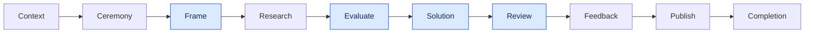

# Project Design lifecycle

Invoke `$design` with the design question or a local design ID. Context Gathering creates the durable record under the project Design stories root. Capture actual source paths, decisions, tradeoffs and the approved destination there.

Record the real review outcome and any addressed feedback before publishing. Publish confirmed decisions into the active project [architecture](<../../Target Architecture (HLD)/README.md>). Completion records the local implementation handoff. Start `$dev` for separately scoped code work.
