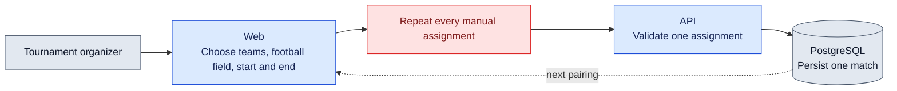

# TQ-001 — Constraint-Based Round-Robin Schedule Generation

## Problem

Manual match assignment does not scale across multiple teams, football fields, playing windows, and minimum-rest rules.

The design must add preview-first generation of every single round-robin pairing, place the fixtures under hard constraints, and preserve the current Web → API → PostgreSQL boundaries and manual scheduling flow.

## Success

### Known ECs

| ID | Evaluation criterion |
| --- | --- |
| EC1 | A single round-robin supports 2–12 teams, including odd counts; every unordered pair appears exactly once, the result contains `N × (N − 1) / 2` matches, and no dummy-team match appears. |
| EC2 | Inputs include tournament dates, a daily playing window, selected registered football fields, match duration, minimum team rest, and a fixed five-minute football field turnaround. |
| EC3 | Every team and football field belongs to the tournament, each match contains two distinct teams, and no pairing is duplicated. |
| EC4 | A team never has overlapping matches. |
| EC5 | A football field never has overlapping matches, and consecutive use respects the turnaround interval. |
| EC6 | Minimum team rest is measured from the end of one match to the start of that team's next match. |
| EC7 | Every match starts and ends within the configured tournament dates and daily playing windows. |
| EC8 | Identical normalized inputs produce identical fixture and placement order. |
| EC9 | Preview returns the proposed matches and a validation report without persistence. |
| EC10 | An independent validator checks the complete generated preview before save. |
| EC11 | Validation remains correct when matches arrive in a non-chronological order. |
| EC12 | A valid preview saves atomically; an incomplete or invalid match schedule never persists partially. |
| EC13 | A concurrent or stale save cannot silently combine with or overwrite another match schedule or existing matches. |
| EC14 | Invalid configuration returns actionable field errors. |
| EC15 | Insufficient theoretical capacity has a distinct failure classification. |
| EC16 | Proven infeasibility is distinct from bounded-search exhaustion or algorithmic failure; the system never claims infeasibility without proof. |
| EC17 | Generation has a bounded execution policy for 2–12 teams. |
| EC18 | Scheduling domain logic remains independent of Spring and JPA; the design adds no infrastructure, paid service, or external integration. |
| EC19 | Automated verification covers invariants, deterministic replay, side-effect-free preview, atomic save, and concurrency; architecture documentation is updated. |
| EC20 | Manual scheduling remains compatible; the exclusions in [TQ-001](<../../../../../requirements/TQ-001.md>) remain outside this design. |

### Proposed ECs

| ID | Proposed evaluation criterion |
| --- | --- |
| PEC1 | [proposed] Define one tournament scheduling time zone and deterministic daylight-saving gap and overlap handling for tournament dates and daily playing windows. |
| PEC4 | [proposed] Return machine-readable validation violations tied to fixture, team, football field, and time references for actionable UI messages. |

## Decisions

| # | Decision | Why it's independent |
| --- | --- | --- |
| 1 | Fixture and placement strategy | Selects fixture construction, deterministic candidate ordering, constraint-search behavior, completeness claims, and execution bounds. It has its own algorithm alternatives and can be approved independently. |
| 2 | Validation and failure model | Defines an independent whole-schedule validator, normalization of out-of-order match input, end-to-start minimum-rest checks, violation reporting, and the distinction among invalid configuration, theoretical capacity failure, proven infeasibility, search exhaustion, and internal failure. |
| 3 | Preview and persistence protocol | Defines preview identity and staleness, existing-match policy, atomic transaction behavior, and concurrent schedule creation. It can change without changing the in-memory generator or validator. |

## Boundaries

| Boundary | Included |
| --- | --- |
| In scope | Single round-robin fixture generation; constrained placement; input normalization and deterministic ordering; independent whole-schedule validation, including unordered input; preview and failure reporting; atomic concurrency-safe save; compatibility with existing manual schedules; automated verification and architecture documentation. |
| Out of scope | Knockout and group stages; global optimization; guaranteed discovery of every feasible schedule; referee assignment; team-specific availability; maximum daily matches; automatic rescheduling; live scoring; authentication; external integrations; new infrastructure or a separate solver service. |

## Constraints

| Area | Constraint |
| --- | --- |
| Architecture | Keep the modular monolith and the existing Web → API → PostgreSQL boundaries. |
| Domain | Keep fixture, placement, and validation rules independent of Spring and JPA and organized by business feature. |
| API | Use REST and Problem Details for validation and generation failures. |
| Ownership | Scope teams, football fields, existing matches, previews, and saved schedules to one tournament. |
| Persistence | Use PostgreSQL 17; apply schema changes only through Flyway; save a generated match schedule in one transaction. |
| Time | Use absolute instants for persisted match times and `TIMESTAMPTZ` in PostgreSQL; browser presentation remains local. |
| Dependencies | Add no abstraction, dependency, infrastructure, or external service without a demonstrated requirement. |
| Lifecycle | This Design Lifecycle produces design artifacts only; application implementation follows through `$dev`. |

## Sizing

| Dimension | Bound or condition | Source |
| --- | --- | --- |
| Teams | 2–12 | [TQ-001](<../../../../../requirements/TQ-001.md>) |
| Fixtures | 1–66, using `N × (N − 1) / 2` | Derived from the team bound |
| Football fields | A selected subset of registered football fields | [TQ-001](<../../../../../requirements/TQ-001.md>) |
| Candidate timeline | Derived from tournament dates, daily windows, match duration, and five-minute turnaround | [TQ-001](<../../../../../requirements/TQ-001.md>) |
| Request pattern | One preview and optional save per organizer action; no throughput target is approved | [System Sizing](<../../../../Target Architecture (HLD)/v1/System Sizing.md>) |
| Execution budget | Bounded execution is required; a quantitative target is unresolved | [TQ-001](<../../../../../requirements/TQ-001.md>) |

## Links

- Ticket: [TQ-001](<../../../../../requirements/TQ-001.md>)
- Related tickets: none
- Target architecture: [active version](<../../../../Target Architecture (HLD)/README.md>), [System Overview](<../../../../Target Architecture (HLD)/v1/System Overview.md>), [Web](<../../../../Target Architecture (HLD)/v1/Containers/Web.md>), [API](<../../../../Target Architecture (HLD)/v1/Containers/API.md>), [PostgreSQL](<../../../../Target Architecture (HLD)/v1/Containers/PostgreSQL.md>), and [System Sizing](<../../../../Target Architecture (HLD)/v1/System Sizing.md>)
- Current implementation: [Manual Scheduling](<../../../../System Architecture (LLD)/API/Manual Scheduling.md>)
