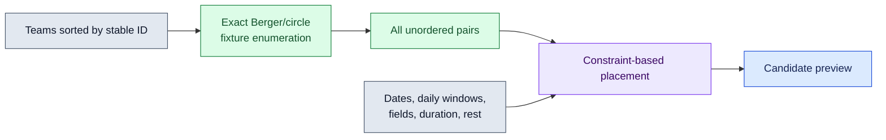
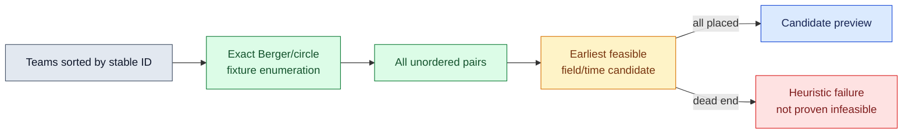
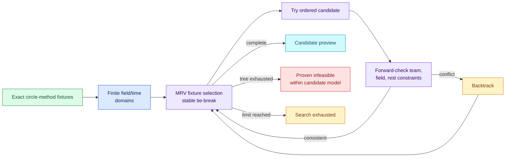
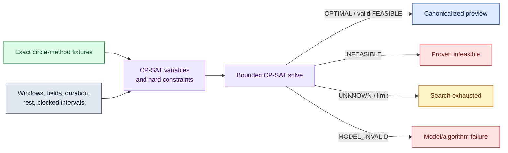

# TQ-001 — Fixture and Placement Strategy Research

_Produced by the 🔍 Research phase. Owned by `@architect`. Do not edit after Evaluate phase begins._

## Context

Fixture enumeration and constrained placement are separate concerns: enumeration must produce every unordered team pair exactly once, while placement must assign every fixture to a football field and time without violating hard constraints.

The common enumeration step is the exact Berger/circle method over teams sorted by stable identifier. For an odd team count, the algorithm adds an internal bye and omits its fixture. This produces `N × (N − 1) / 2` real fixtures before placement. Schaerf describes the established split between round-robin patterns and constraint assignment, while the FIDE Berger tables document canonical pairings and byes ([Schaerf](https://doi.org/10.1023/A%3A1009845710839), [FIDE](https://handbook.fide.com/files/handbook/C02Standards.pdf)).

The requirements allow bounded search without guaranteeing discovery of every feasible schedule ([TQ-001](<../../../../../requirements/TQ-001.md>)). The [Frame](<00 Frame.md>) requires deterministic results, honest separation of infeasibility from exhaustion, independent validation, and the existing Web → API → PostgreSQL boundaries. The current implementation validates and persists one explicit match per transaction, reads the match schedule chronologically, and has no solver dependency ([Manual Scheduling](<../../../../System Architecture (LLD)/API/Manual Scheduling.md>), [backend/pom.xml](<../../../../../backend/pom.xml>)). No approved latency or concurrency target exists for this local demo ([System Sizing](<../../../../Target Architecture (HLD)/v1/System Sizing.md>)).

| Project evidence | Constraint on the options |
| --- | --- |
| [TQ-001 requirements](<../../../../../requirements/TQ-001.md#L15-L20>) and [explicit exclusions](<../../../../../requirements/TQ-001.md#L95-L103>) | Generate every exact pairing, but do not claim guaranteed discovery of every feasible placement. |
| [Frame success criteria](<00 Frame.md#L40-L58>) and [architecture constraints](<00 Frame.md#L76-L94>) | Keep results deterministic and bounded, classify exhaustion honestly, and preserve the modular monolith. |
| [Manual Scheduling](<../../../../System Architecture (LLD)/API/Manual Scheduling.md#L31-L46>) and [MatchAssignment](<../../../../../backend/src/main/java/com/artisyn/tournamentiq/match/domain/MatchAssignment.java#L14-L24>) | Current domain validation covers one explicit assignment, distinct teams, and positive duration; generation requires separate whole-schedule reasoning. |
| [MatchService](<../../../../../backend/src/main/java/com/artisyn/tournamentiq/match/application/MatchService.java#L42-L56>), [TeamRepository](<../../../../../backend/src/main/java/com/artisyn/tournamentiq/team/persistence/TeamRepository.java#L9-L12>), and [FieldRepository](<../../../../../backend/src/main/java/com/artisyn/tournamentiq/field/persistence/FieldRepository.java#L9-L12>) | Team and football field resolution is scoped to one tournament. |
| [MatchController](<../../../../../backend/src/main/java/com/artisyn/tournamentiq/match/api/MatchController.java#L30-L49>), [web API client](<../../../../../frontend/src/api.ts#L6-L27>), and [tournament workspace](<../../../../../frontend/src/App.tsx#L113-L122>) | Generated preview must fit the existing REST and Web ownership boundaries. |
| [backend/pom.xml](<../../../../../backend/pom.xml#L22-L64>) and [System Sizing](<../../../../Target Architecture (HLD)/v1/System Sizing.md#L24-L39>) | No solver dependency exists, and no approved latency or concurrency target selects one. |

## Options

### Option A — Canonical fixtures with deterministic earliest-fit greedy placement

**Description:** Enumerate exact fixtures in canonical round and fixture order. For each fixture, select the earliest feasible candidate ordered by start instant and then football field identifier. The algorithm does not reconsider a placement.

**Industry precedent:** Berger tables provide the canonical pairing pattern. Graham's list-scheduling work is the standard precedent for greedy ordered assignment ([Graham](https://doi.org/10.1002/j.1538-7305.1966.tb01709.x)).

| Property | Assessment |
| --- | --- |
| Completeness | Fixture enumeration is exact. Placement is incomplete; a dead end does not prove infeasibility. |
| Determinism | Stable team numbering, fixture order, start-instant order, and football field order avoid unordered iteration. |
| Bounds | Approximately `O(F × C × K)` for `F ≤ 66` fixtures, `C` candidates, and `K` constraint checks; the candidate count requires an explicit cap. |
| Project compatibility | Small implementation footprint and no dependency. Suitability for tight constraints is not established. |

**Pros:**

- Uses no new dependency and is straightforward to test, explain, and replay.
- Runs quickly when capacity is abundant.

**Cons:**

- Early choices can block a schedule that another placement order would find.
- Cannot classify a dead end as proven infeasibility.
- Success depends strongly on fixture and candidate ordering.

**Unknowns / risks:** Its success rate for tight date, rest, turnaround, and football field configurations requires representative benchmarks.

### Option B — Canonical fixtures with deterministic CSP backtracking

**Description:** Build a finite candidate domain for every exact fixture, then use depth-first backtracking with forward checking. Select the fixture with the smallest remaining domain, break ties canonically, try candidates ordered by start instant and football field identifier, and undo choices on conflict.

**Industry precedent:** Constraint-programming models for sports timetabling separate pattern generation from constrained assignment and use search with propagation ([Schaerf](https://doi.org/10.1023/A%3A1009845710839)).

| Property | Assessment |
| --- | --- |
| Completeness | Exhausting the finite candidate tree proves infeasibility only within that candidate model. Reaching a work limit is search exhaustion, not infeasibility. |
| Determinism | Domain construction, minimum-remaining-values ties, value order, and conflict order must be stable. Public outcomes use deterministic node or propagation counts; wall-clock time is only a safety stop. |
| Bounds | Explicit node, propagation, and depth limits bound execution, with a safety deadline. Worst-case search is exponential, approximately `C^F`. |
| Project compatibility | Pure Java and no solver dependency fit the modular monolith. `F ≤ 66` is modest, but date span, football field count, and candidate density are unbounded today. |

**Pros:**

- Reconsiders early choices and can find schedules missed by greedy placement.
- Proves infeasibility when the complete finite tree is exhausted.
- Keeps domain logic independent of Spring and JPA without a new dependency.

**Cons:**

- Requires custom solver, propagation, and limit-accounting code.
- Performance remains sensitive to variable and candidate ordering.
- Worst-case execution is exponential.

**Unknowns / risks:** The finite candidate model and effective work limits are undefined. Representative benchmarks must show whether a custom search remains maintainable and responsive at the approved bounds.

### Option C — Canonical fixtures with embedded CP-SAT placement

**Description:** Keep exact fixture enumeration in the domain, then encode finite start and football field choices, non-overlap, turnaround, and end-to-next-start rest constraints in an embedded CP-SAT model. Interpret solver status explicitly and pass every successful assignment to the independent validator.

**Industry precedent:** OR-Tools CP-SAT supports finite-domain constraint models and exposes distinct `OPTIMAL`, `FEASIBLE`, `INFEASIBLE`, `MODEL_INVALID`, and `UNKNOWN` outcomes ([CP-SAT overview](https://developers.google.com/optimization/cp), [solver statuses](https://or-tools.github.io/docs/java/enumcom_1_1google_1_1ortools_1_1sat_1_1CpSolverStatus.html), [solver parameters](https://or-tools.github.io/docs/java/classcom_1_1google_1_1ortools_1_1sat_1_1SatParameters.html)).

| Property | Assessment |
| --- | --- |
| Completeness | `INFEASIBLE` proves the encoded finite model has no solution; `UNKNOWN` or a limit means search exhaustion. A successful solver result still requires independent validation. |
| Determinism | Stable model construction, fixed seed, one worker, fixed decision strategy, pinned solver version, and canonical output ordering reduce variability. Cross-version identity is not guaranteed. |
| Bounds | Time, conflict, or deterministic-work limits bound solving. A candidate-selection encoding is roughly `F × C` Boolean variables before auxiliary constraints. |
| Project compatibility | The maximum of 66 fixtures is modest, but candidate density is not bounded. The Java/native dependency must justify its image, platform, and maintenance cost. |

**Pros:**

- Uses mature search and propagation for scheduling constraints.
- Exposes solver outcomes that map to success, infeasibility, invalid model, and exhaustion.
- Avoids implementing a general-purpose search engine in application code.

**Cons:**

- Adds a sizable Java/native dependency and specialist modeling knowledge.
- Solver upgrades can change returned schedules even when both are valid.
- Adds packaging and platform concerns to the local Docker build.

**Unknowns / risks:** Docker architecture support, dependency size, pinned-version maintenance, finite candidate construction, and reproducibility need validation. The dependency must demonstrate material benefit over project-owned search.

## Open Questions

The following triage is proposed for developer confirmation; it does not select a placement option. `V` marks a value decision for confirmation, and `E` marks an input to evaluation or benchmarking.

| # | V/E | Proposed answer or evaluation status |
| --- | --- | --- |
| A-OQ1 | V | **Proposed resolved:** Generation inputs use an explicit tournament IANA `ZoneId`. Durations and rest use whole minutes. Candidate starts are a finite one-minute grid inside resolved daily windows. Daylight-saving gaps and ambiguous local times are rejected instead of silently selecting an offset. |
| A-OQ2 | E | The exact maximum date span, football field count, and deterministic candidate-count cap remain evaluation and benchmark inputs. Every option must reject a configuration that exceeds its finite candidate bound. |
| A-OQ3 | V | **Proposed resolved:** Identical normalized inputs must produce an identical result within the same released application version. Identical match schedules across application versions are not promised. |
| A-OQ4 | E | The exact node or work limit remains an evaluation and benchmark input. Public outcomes use deterministic work units; wall-clock time is only a safety stop. |
| A-OQ5 | E | **Proposed resolved:** Any deterministic valid placement is acceptable. Lexicographic optimality and global optimization are not required. |
| A-OQ6 | V | **Proposed resolved:** Generation and save apply only when the tournament has no existing matches. Existing matches produce an explicit conflict; the workflow neither merges nor overwrites them. |
