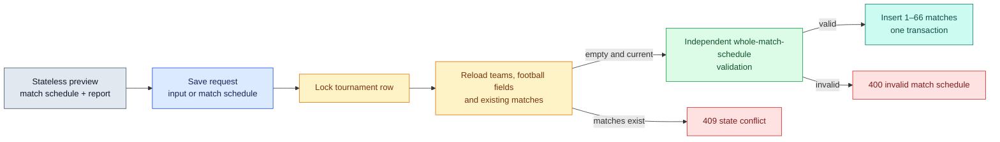
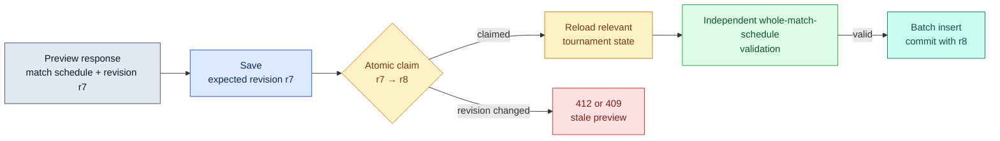
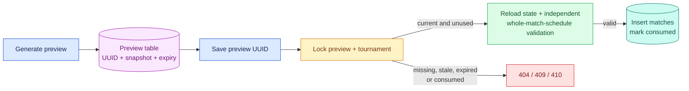
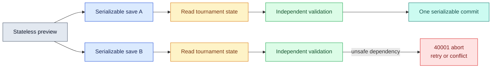

# TQ-001: Preview and Persistence Protocol — Research

_Produced by the 🔍 Research phase. Owned by `@architect`. Do not edit after Evaluate phase begins._

## Context

The protocol must keep preview side-effect free, save 1–66 generated matches atomically, reject stale or concurrent combination, and preserve the existing manual scheduling flow.

Current evidence bounds the options:

- `MatchService.create` persists one match in one `@Transactional` call; it does not provide a batch match schedule transaction.
- `MatchRepository` provides chronological reads but no lock, revision or preview-identity operation.
- Tournament and match entities have no optimistic version or schedule revision.
- Flyway constraints protect ownership, distinct teams and positive duration, but not complete match schedules or preview freshness.
- The frontend submits individual match creations and does not retain ETags, revisions or machine-readable problem codes.
- The deployed Web → API → PostgreSQL topology has no auxiliary state service, and the active sizing document defines no concurrency or latency target.

Every option still needs independent whole-schedule validation before the first intended insert. Calling the current single-match operation repeatedly cannot satisfy atomic save.

## Options

### Option P1 — Stateless Preview with Tournament Row Lock

**Description:** Preview returns a generated match schedule and validation report without persistence or a preview ID. Save resubmits normalized generation input or the complete preview. One transaction locks the tournament row, reloads registered teams, football fields and existing matches, rejects a nonempty match schedule, independently validates the proposal, and inserts every match. Manual match creation must use the same tournament lock protocol so it cannot race the generated save.

**Industry precedent:** Spring Data JPA exposes pessimistic repository locks through [`@Lock`](https://docs.spring.io/spring-data/jpa/reference/jpa/locking.html). PostgreSQL row locks serialize competing writers until transaction completion ([PostgreSQL explicit locking](https://www.postgresql.org/docs/17/explicit-locking.html)). Spring declarative transactions roll back unchecked failures by default ([Spring rollback rules](https://docs.spring.io/spring-framework/reference/6.2/data-access/transaction/declarative/rolling-back.html)).

**Diagram:**

**Pros:**

- Uses existing Spring Data JPA and PostgreSQL capabilities.
- Provides one explicit per-tournament serialization point.
- Adds no schema, dependency, preview lifecycle or cleanup process.
- Supports a direct concurrency test with two save transactions.

**Cons:**

- Detects preview staleness only at save time.
- Does not prove that the submitted payload is the exact response previously previewed.
- Validation or regeneration inside the transaction can extend lock duration.
- Every match-schedule writer must use the same lock order and protocol.

**Unknowns / risks:**

- A bounded lock wait and deadlock policy remains an implementation and test input.
- Deterministic regeneration and full-preview resubmission have different payload and transaction costs.
- Registration changes between preview and save must be included in transaction-time state checks.

---

### Option P2 — Stateless Preview with Optimistic Schedule Revision

**Description:** Preview remains non-persistent and returns a tournament schedule revision, optionally as a strong ETag. Save sends the expected revision with the complete proposal or normalized input. The transaction atomically claims the revision, reloads relevant state, independently validates the match schedule, inserts every match, and advances the revision. Manual match creation and relevant registration changes must advance the same revision.

**Industry precedent:** HTTP `If-Match` prevents lost updates and uses `412 Precondition Failed` for a failed precondition ([RFC 9110 §13.1.1](https://www.rfc-editor.org/rfc/rfc9110.html#section-13.1.1)). Jakarta Persistence defines version attributes and optimistic lock failure semantics ([Jakarta Persistence optimistic locking](https://jakarta.ee/learn/docs/jakartaee-tutorial/current/persist/persistence-locking/persistence-locking.html)).

**Diagram:**

**Pros:**

- Makes preview freshness explicit to the API client and tests.
- Rejects competing saves through one atomic state claim.
- Uses standard HTTP lost-update semantics when represented as an ETag.
- Adds no server-side preview storage or cleanup.

**Cons:**

- Adds a Flyway-managed revision column or schedule-state table.
- Requires every invalidating mutation to advance the same revision.
- A matching revision proves freshness, not domain validity, so independent validation remains mandatory.
- Token handling adds client and API state beyond the confirmed preview requirement.

**Unknowns / risks:**

- The invalidation scope must cover matches, teams, football fields and generation configuration consistently.
- JPA child insertion does not inherently advance a parent `@Version`; the transaction must claim the revision explicitly.
- ETag/`412` and JSON revision/`409` produce different API contracts.

---

### Option P3 — Server-Stored Consumable Preview

**Description:** Preview stores a UUID, tournament snapshot, normalized input, proposed match schedule, validation result and expiry metadata in PostgreSQL. Save references the UUID, locks both preview and tournament state, revalidates against current registrations, inserts all matches, and marks the preview consumed in one transaction. Distinct previews still require a tournament-level lock or revision.

**Industry precedent:** PostgreSQL row locks support exclusive state transitions and atomic one-time consumption within a transaction ([PostgreSQL explicit locking](https://www.postgresql.org/docs/17/explicit-locking.html)).

**Diagram:**

**Pros:**

- Gives the server a stable preview identity and exact payload.
- Supports one-time consumption and explicit stale or expired states.
- Can support future resume, sharing or audit requirements.

**Cons:**

- Persists preview data despite the confirmed side-effect-free preview requirement.
- Adds Flyway schema, retention, expiry and cleanup behavior.
- Still needs tournament-level concurrency control for distinct previews and manual writes.
- Adds lifecycle state without a confirmed resume, sharing or audit use case.

**Unknowns / risks:**

- The confirmed interpretation of “preview without persistence” makes this option nonviable unless that requirement changes.
- Stored validation becomes stale and cannot replace validation at save time.
- Retention, cleanup and recovery semantics have no approved operational target.

---

### Option P4 — Stateless Preview with Serializable Save

**Description:** Preview is stateless. Save runs at PostgreSQL `SERIALIZABLE`, reloads all relevant tournament state, rejects a nonempty match schedule, independently validates the proposal, and inserts all matches in one transaction. Concurrent transactions that form an unsafe dependency cause one transaction to abort; the API retries the whole transaction within a bound or returns a retryable conflict.

**Industry precedent:** PostgreSQL serializable isolation detects unsafe read/write dependencies and aborts a transaction when required to preserve serial execution ([PostgreSQL transaction isolation](https://www.postgresql.org/docs/17/transaction-iso.html)).

**Diagram:**

**Pros:**

- Uses PostgreSQL's native anomaly detection.
- Adds no preview state, schema or dependency.
- Preserves atomicity across the whole batch.

**Cons:**

- Adds serialization-failure translation and whole-transaction retry behavior.
- Requires all competing match-schedule writers to use compatible transactions and predicates.
- A manual write at default isolation can leave the intended protection incomplete.
- Uses stricter database machinery than the demonstrated local workload requires.

**Unknowns / risks:**

- The exact predicates needed for competing inserts require PostgreSQL 17 integration tests.
- Retry count and execution-budget accounting remain implementation inputs.
- Serializable isolation does not replace domain validation or coordinate non-participating writers.

## Open Questions

The Research sign-off confirms the following viability and evaluation-input classifications before Evaluate begins.

| # | Open question | V/E | Proposed answer / status |
| --- | --- | --- | --- |
| P-OQ1 | Must save reject an existing match schedule, merge with it, or overwrite it? | (V) | Resolved: reject a tournament with any existing matches; do not merge or overwrite. |
| P-OQ2 | Does side-effect-free preview prohibit server-side preview storage? | (V) | Resolved: yes. This makes P3 nonviable unless the requirement changes. |
| P-OQ3 | Must save prove exact preview identity through a token or fingerprint? | (V) | Resolved: no. Deterministic regeneration or resubmission plus transaction-time reload and revalidation is sufficient. |
| P-OQ4 | Which tournament state must save reload before persistence? | (E) | Resolved: reload relevant teams, football fields and matches; conflicting relevant state fails. |
| P-OQ5 | Which HTTP contract represents stale optimistic state? | (E) | Resolved: use `409 Conflict` with Problem Details for the current architecture; `If-Match` with `412` remains part of P2 if that option survives Evaluate. |
| P-OQ6 | Must previews survive browser refresh or API restart, or support sharing and audit? | (V) | Resolved: no. |
| P-OQ7 | What bound applies to lock waits, deadlocks and serialization retries? | (E) | Open implementation/test input: apply a bounded policy and distinguish state conflict from internal failure; select the threshold during implementation planning and verification. |

## Cross-Option Constraints

The persistence protocol does not replace match-schedule validation or failure classification.

| Concern | Constraint across all options |
| --- | --- |
| Preview | Do not insert match or preview records. |
| Existing matches | Reject generated save when any match exists for the tournament. |
| Validation | Validate the complete proposal independently before the first intended insert. |
| Atomicity | Use one outer transaction for validation and every match insert. |
| Concurrency | Coordinate generated save and manual match creation through the same tournament state protocol. |
| Failure response | Use machine-readable Problem Details; distinguish invalid input, state conflict, bounded retry exhaustion and internal failure. |
| Frontend | Preserve the Problem Details `code` and multiple structured violations. |
