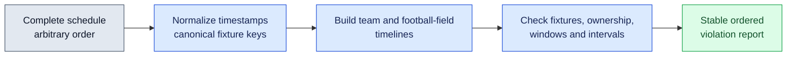
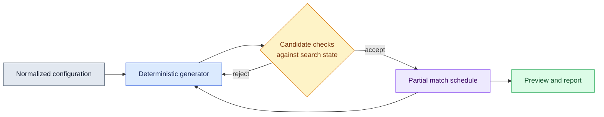
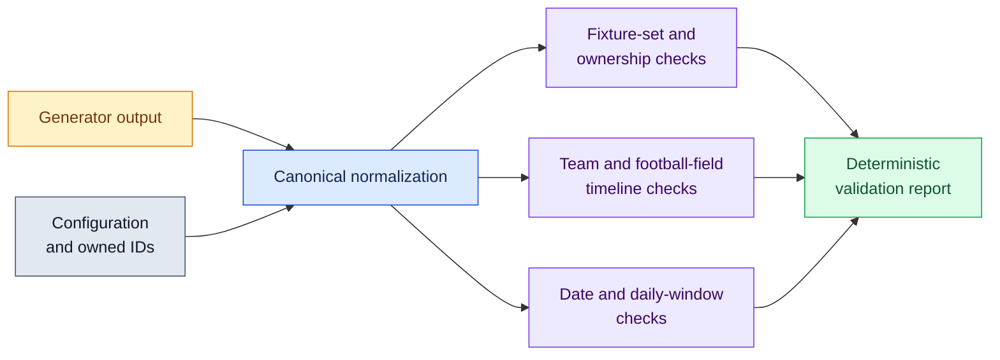
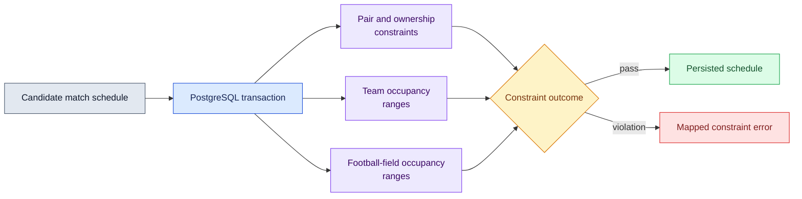
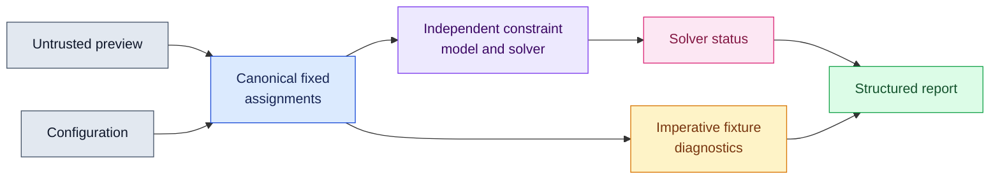

# TQ-001 — Validation and Failure Model Research

_Produced by the 🔍 Research phase. Owned by `@architect`. Do not edit after Evaluate begins._

## Context

The validator must treat the complete proposed match schedule as untrusted input, enforce every hard constraint independently of generation, and return deterministic results when matches arrive in any order.

Current implementation evidence bounds the alternatives:

| Evidence | Consequence |
| --- | --- |
| [`MatchAssignment`](<../../../../../backend/src/main/java/com/artisyn/tournamentiq/match/domain/MatchAssignment.java>) rejects only identical teams and non-forward intervals. | The current domain object does not enforce schedule-wide constraints. |
| [`MatchService`](<../../../../../backend/src/main/java/com/artisyn/tournamentiq/match/application/MatchService.java>) checks tournament ownership and saves one match. | It does not validate neighbors, overlaps, rest, turnaround, pairing completeness, or daily windows. |
| [`MatchRepository`](<../../../../../backend/src/main/java/com/artisyn/tournamentiq/match/persistence/MatchRepository.java>) sorts matches only when reading. | Presentation order cannot protect an unordered write. |
| [Flyway V1](<../../../../../backend/src/main/resources/db/migration/V1__create_tournament_schema.sql>) enforces ownership, distinct teams, and a positive duration. | PostgreSQL does not currently enforce cross-row time or fixture-set rules. |
| [`TournamentApiIntegrationTest`](<../../../../../backend/src/test/java/com/artisyn/tournamentiq/TournamentApiIntegrationTest.java>) inserts a later match before an earlier match with the same teams and football field. | Both writes succeed; chronological display alone does not validate insertion order. |
| [`ApiErrors`](<../../../../../backend/src/main/java/com/artisyn/tournamentiq/shared/api/ApiErrors.java>) emits Problem Details with a code and field errors, while [`api.ts`](<../../../../../frontend/src/api.ts>) discards the code and collapses errors by field. | Generated-schedule violations require an additive machine-readable contract and client preservation of repeated violations. |

The accepted [Frame](<00 Frame.md>) requires exact unordered-pair coverage, end-to-start minimum rest, independent validation, correct unordered-input handling, and distinct generation outcomes.

## Shared Validation Vocabulary

Every alternative needs an explicit total order before it can produce deterministic validation output.

The common normalization steps are:

1. Normalize timestamps to PostgreSQL microsecond precision.
2. Represent each fixture by a canonical unordered team key under one defined UUID order.
3. Sort matches by start, end, fixture key, and football-field ID.
4. Build independently sorted timelines for each team and football field.
5. Detect overlaps over the complete timelines.
6. Compare chronological neighbors using `next.start >= previous.end + required interval`.
7. Compare the actual fixture multiset with the expected `N × (N − 1) / 2` set.

Java 21 [`Comparator`](https://docs.oracle.com/en/java/javase/21/docs/api/java.base/java/util/Comparator.html) provides the standard total-order contract. RFC 9457 permits Problem Details extensions that identify individual validation occurrences and their locations ([RFC 9457 §3.2](https://www.rfc-editor.org/rfc/rfc9457.html#section-3.2)).

The generation outcome is separate from the violation list:

| Classification | Meaning |
| --- | --- |
| `INVALID_CONFIGURATION` | Input is malformed or semantically invalid before search. |
| `INSUFFICIENT_THEORETICAL_CAPACITY` | A documented necessary capacity bound fails. |
| `PROVEN_INFEASIBLE` | The complete modeled search space was exhausted without a valid schedule. |
| `SEARCH_LIMIT_EXHAUSTED` | A deterministic work bound or safety limit ended search without a schedule or proof. |
| `INTERNAL_FAILURE` | An exception, invalid model, or independently rejected generator result occurred. |
| `SCHEDULE_INVALID` | A submitted preview or save candidate contains structured violations; this does not prove the problem infeasible. |

This distinction follows the important CP-SAT status boundary: `INFEASIBLE` is a proof, while `UNKNOWN` includes termination before either a solution or proof ([OR-Tools CP-SAT statuses](https://developers.google.com/optimization/cp/cp_solver)).

## Options

### Option A — Generator-Coupled Incremental Checks

**Description:** The generator checks each candidate against assignments already in its search state. Final assertions can verify match count and fixture uniqueness, but constraint predicates and ordering assumptions remain generator-owned.

**Industry precedent:** Constructive schedulers and backtracking searches commonly use incremental feasibility checks to prune partial assignments. The pattern is an effective search mechanism, but it is not independent verification.

**Diagram:**

**Pros:**

- Adds no dependency and keeps checks near search decisions.
- Prunes invalid partial assignments before deeper search.
- Fits Spring- and JPA-free Java domain logic.

**Cons:**

- Shares generator state, predicates, and ordering assumptions, so it does not satisfy independent validation by itself.
- Fail-fast search checks do not naturally produce a stable report for the complete schedule.
- A latest-match-only check misses a predecessor or successor when a match is inserted out of chronological order.

**Unknowns / risks:**

- Correct unordered validation requires canonical timelines or checks against both chronological neighbors.
- Minimum rest must compare the preceding match end with the next match start, not two start times.
- A final assertion can detect an internal defect but cannot provide implementation independence.

---

### Option B — Independent Pure Whole-Schedule Validator

**Description:** A separate, Spring- and JPA-free validator consumes configuration, tournament-owned IDs, and the complete proposed schedule. It rebuilds canonical timelines and fixture sets without reading generator search state or trusting generator claims.

**Industry precedent:** Pure validation layers are used at trust boundaries to recheck generated or imported data. Java total ordering and RFC 9457 occurrence lists provide standard ordering and response contracts.

**Diagram:**

**Pros:**

- Covers the complete preview independently and is insensitive to arrival order.
- Produces immutable violations in a stable public order.
- Supports permutation, mutation, and property-style tests with no database.
- Has bounded cost for the maximum 66 matches and adds no dependency.

**Cons:**

- Some rules exist both in generator pruning and validator evaluation.
- Semantic drift is possible unless invariant tests exercise both implementations.
- It does not protect against state changes during persistence by itself.

**Unknowns / risks:**

- Independence permits shared immutable value types and timestamp normalization, but not shared constraint predicates or search state.
- The API must preserve multiple violations for the same fixture or field.
- Tournament time-zone and daylight-saving normalization must be explicit before window validation is unambiguous.

---

### Option C — PostgreSQL Constraint-Led Validation

**Description:** PostgreSQL range, exclusion, unique, and ownership constraints enforce the temporal and pairing subset that can be represented relationally. Team occupancy likely needs separate participant rows because two team columns cannot detect the same team in opposite roles.

**Industry precedent:** PostgreSQL documents exclusion constraints as a method for preventing overlapping reservations ([range constraints](https://www.postgresql.org/docs/17/rangetypes.html#RANGETYPES-CONSTRAINT)). It also directs cross-row rules away from `CHECK` constraints toward `UNIQUE`, `EXCLUDE`, or foreign keys ([constraint guidance](https://www.postgresql.org/docs/17/ddl-constraints.html#DDL-CONSTRAINTS-CHECK-CONSTRAINTS)).

**Diagram:**

**Pros:**

- Enforces represented invariants regardless of insertion order and across concurrent transactions.
- Provides durable protection after application validation.
- Uses the existing database instead of a new service.

**Cons:**

- Cannot validate a non-persistent preview without speculative writes or a second validator.
- Fixture completeness, daily windows, and outcome classification remain application rules.
- Adds schema structures and can require `btree_gist` for composite exclusion constraints.
- Global constraints could change current manual scheduling behavior.

**Unknowns / risks:**

- Configurable team rest complicates stored occupancy intervals.
- Constraint errors provide less complete multi-violation diagnostics than an in-memory report.
- Generated-schedule scoping is required to avoid applying new rules to the unchanged manual endpoint.

---

### Option D — Independent Constraint-Model Replay

**Description:** A second constraint model fixes every proposed match to its supplied teams, football field, and time. The model verifies temporal feasibility, while imperative checks still diagnose ownership, missing fixtures, and duplicate pairings.

**Industry precedent:** Constraint programming models set-based scheduling rules and exact status outcomes; OR-Tools documents both the approach and CP-SAT result semantics ([constraint programming](https://developers.google.com/optimization/cp), [CP-SAT statuses](https://developers.google.com/optimization/cp/cp_solver)).

**Diagram:**

**Pros:**

- Uses a set-based model that is insensitive to input order.
- Can provide implementation separation when its model is independently encoded.
- Reuses formal solver status semantics.

**Cons:**

- Adds a solver dependency and potentially native runtime artifacts for at most 66 fixed matches.
- Solver feasibility alone does not produce actionable fixture-level violations.
- A generator and validator using the same model retain common-mode modeling defects.
- An infeasible fixed preview proves only that preview invalid, not that the scheduling problem has no solution.

**Unknowns / risks:**

- Useful diagnostics can require assumption literals, unsatisfiable cores, or duplicate imperative checks.
- Solver determinism and execution bounds need explicit configuration.
- The dependency and operational cost require a demonstrated benefit over direct validation.

## Comparison

| Option | Generator independence | Complete preview coverage | Unordered input can evade checks | Additional dependency or schema |
| --- | --- | --- | --- | --- |
| A. Generator-coupled checks | Low | Conditional | Yes if append order is assumed | None |
| B. Pure whole-schedule validator | High | Yes | No; it rebuilds canonical timelines | None |
| C. PostgreSQL constraints | Medium for persisted subset | No, not alone | No for represented constraints | Schema and possibly `btree_gist` |
| D. Constraint-model replay | Conditional | Yes if fully modeled | No for correctly quantified constraints | Solver dependency |

## Open Questions

These classifications and answers are proposed for the Research sign-off; Evaluate must use only the confirmed result.

| # | Open question | V/E | Proposed answer / status |
| --- | --- | --- | --- |
| V-OQ1 | Must current manual submissions continue accepting duplicate pairings and zero turnaround? | (V) | Yes. Keep the existing single-match endpoint unchanged. Scope generated-schedule rules to preview and save; global database constraints that alter manual behavior are unsuitable. |
| V-OQ2 | May generation run when tournament matches already exist? | (V) | No. Preview and save require an empty tournament match schedule; do not merge with or overwrite manual matches. |
| V-OQ3 | Which time zone and daylight-saving policy governs dates and daily windows? | (V) | Require one explicit IANA `ZoneId`; reject invalid and ambiguous local date-times deterministically instead of choosing an offset silently. |
| V-OQ4 | What qualifies as insufficient theoretical capacity? | (E) | Unresolved evaluation input. A documented capacity calculation is a necessary lower bound only and never proves infeasibility. |
| V-OQ5 | How does exhaustive search differ from a bounded stop? | (E) | Exhausting the complete modeled space can return `PROVEN_INFEASIBLE`; stopping at a bound returns `SEARCH_LIMIT_EXHAUSTED`. |
| V-OQ6 | Must validation report every conflict or only a sufficient invalidity set? | (E) | Report all deterministic violations. The 66-match maximum bounds pairwise conflict checks and report construction. |
| V-OQ7 | What may the validator share with the generator? | (E) | Share immutable value types and timestamp normalization only; do not share generator constraint predicates or search state. |
| V-OQ8 | Are violation codes and ordering part of the REST contract? | (E) | Yes. Keep codes and ordering stable; the Web client preserves repeated violations and their machine-readable code. |
| V-OQ9 | How is generator output rejected by independent validation classified? | (E) | Return `INTERNAL_FAILURE` with sanitized structured diagnostics; do not blame user configuration or claim infeasibility. |
