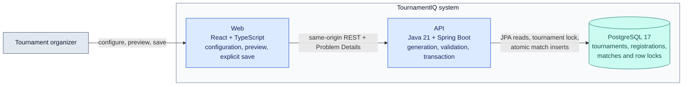

# TQ-001 — Constraint-Based Round-Robin Schedule Generation Architecture

Generated scheduling extends the existing Web → API → PostgreSQL flow without adding a runtime container, service, dependency or database schema.

## System boundary



| Boundary | Target responsibility | Contract delta |
| --- | --- | --- |
| Web | Collect tournament dates, daily playing window, scheduling time zone, selected football fields, match duration and minimum team rest; show the complete preview and validation report; require explicit save; preserve every structured violation. | Adds preview and generated-save calls and corresponding loading, success, invalid, exhausted and conflict states. Existing registration, manual match and match-schedule views remain. |
| API | Normalize input, construct exact single round-robin fixtures, place them with deterministic bounded CSP backtracking, validate the complete result independently, expose Problem Details and coordinate all match-schedule writes. | Adds two REST operations and a tournament-first lock protocol inside the existing modular monolith. |
| PostgreSQL | Retain durable tournament, team or field registration and match data; provide the tournament row serialization point and atomic transaction boundary. | Uses the existing schema. Preview creates no row and generated save inserts only existing match rows. |

The target remains the local Docker Compose deployment documented by the [active architecture](<../../../../Target Architecture (HLD)/v1/System Overview.md>). The browser still reaches the API through Nginx or the Vite proxy, and the API remains the only PostgreSQL client.

## End-to-end control flow

Preview and save are separate organizer actions. The API never treats a successful preview as permission to persist.

```mermaid
sequenceDiagram
    actor O as Organizer
    participant W as Web
    participant A as API
    participant V as Independent validator
    participant D as PostgreSQL

    rect rgb(219, 234, 254)
        O->>W: Submit scheduling configuration
        W->>A: POST /schedule/preview
        A->>D: Read tournament, teams, football fields, matches
        D-->>A: Tournament-scoped state
        alt Match schedule is not empty
            A-->>W: 409 SCHEDULE_STATE_CONFLICT
            W-->>O: Existing match schedule; generation is unavailable
        else Match schedule is empty
            A->>A: Normalize, enumerate fixtures, bounded CSP placement
            alt Configuration, capacity or search outcome prevents preview
                A-->>W: Problem Details with stable code
                W-->>O: Actionable failure state
            else Placement produces a candidate
                A->>V: Validate complete proposal in arbitrary order
                V-->>A: Stable validation report
                alt Independent validation rejects generated output
                    A-->>W: 500 INTERNAL_FAILURE
                    W-->>O: Generation failed without persistence
                else Candidate is valid
                    A-->>W: Proposed matches + report
                    W-->>O: Render preview; no durable write
                end
            end
        end
    end

    opt Organizer explicitly saves a returned preview
        O->>W: Save preview
        W->>A: POST /schedule with complete proposal and configuration
        A->>D: Begin transaction; lock tournament row
        D-->>A: Serialized tournament state
        A->>D: Reload teams, football fields and matches
        alt Match schedule is no longer empty or state conflicts
            A-->>D: Roll back
            A-->>W: 409 SCHEDULE_STATE_CONFLICT
            W-->>O: Refresh and generate a new preview
        else State is current
            A->>V: Validate complete submitted proposal again
            alt Validation fails
                V-->>A: Deterministic violations
                A-->>D: Roll back
                A-->>W: SCHEDULE_INVALID or INTERNAL_FAILURE
            else Validation passes
                A->>D: Insert every match; commit once
                D-->>A: Persisted match schedule
                A-->>W: Saved match schedule
                W-->>O: Render persisted schedule
            end
        end
    end
```

The save transaction acquires the tournament lock before it reloads state. Generated save, `POST /matches`, and team or field registration writes acquire that same tournament row first. A transaction takes at most one tournament lock, so its canonical order is tournament → scoped rows → match writes. A lock timeout or deadlock rolls back and returns `409 SCHEDULE_STATE_CONFLICT`; the organizer refreshes before retrying.

## Boundary contracts

| Operation | Success contract | Failure contract | Persistence |
| --- | --- | --- | --- |
| `POST /api/tournaments/{tournamentId}/schedule/preview` | For an empty match schedule, returns normalized configuration, proposed matches in canonical order and a validation report. | Returns `409 SCHEDULE_STATE_CONFLICT` before fixture generation when any match exists; other failures use Problem Details with one stable outcome code and zero or more ordered structured violations. | Read-only. |
| `POST /api/tournaments/{tournamentId}/schedule` | Accepts the complete preview proposal plus its configuration context; returns the persisted match schedule after one commit. | `400` for invalid input or schedule, `409 SCHEDULE_STATE_CONFLICT` for stale/concurrent state, `422` for a valid request that cannot produce a match schedule under the bounded policy, and `500 INTERNAL_FAILURE` for an implementation fault. | One transaction inserts all matches or none. |
| `GET /api/tournaments/{tournamentId}/schedule` | Returns the persisted match schedule chronologically. | Existing not-found and API error behavior remains. | Read-only. |
| `POST /api/tournaments/{tournamentId}/matches` | Retains the existing manual single-match request and response. | Existing manual validation semantics remain; the write joins the tournament lock protocol. | One manual match transaction. |

Structured violations contain a stable `code`, `path` and applicable fixture, team, football field and time references. Their canonical order is independent of request order. The Web preserves repeated violations instead of collapsing them by field.

| Outcome code | Meaning |
| --- | --- |
| `INVALID_CONFIGURATION` | Input is missing, malformed, outside the finite-domain policy or semantically inconsistent before search. |
| `INSUFFICIENT_THEORETICAL_CAPACITY` | A documented necessary capacity lower bound fails; the result is not a general infeasibility proof. |
| `PROVEN_INFEASIBLE` | The deterministic search exhausted the complete configured finite candidate tree. |
| `SEARCH_LIMIT_EXHAUSTED` | Deterministic work units reached their configured bound without a match schedule or proof. |
| `SCHEDULE_INVALID` | A submitted proposal contains independent whole-match-schedule violations. |
| `SCHEDULE_STATE_CONFLICT` | Existing matches, concurrent changes, lock timeout or deadlock prevent this save. |
| `INTERNAL_FAILURE` | Generation, validation or persistence violated an internal invariant, failed unexpectedly or hit the non-deterministic wall-clock safety stop. |

## Scheduling and validation invariants

The API produces one valid deterministic result for one normalized input within the same released application version.

| Invariant | Target rule |
| --- | --- |
| Fixture set | Sort real teams by stable identifier, apply exact Berger/circle enumeration, omit the internal bye for odd counts and emit each unordered pair once. |
| Candidate time | Resolve tournament-local dates and daily windows through one explicit IANA `ZoneId`; generate whole-minute candidate starts; reject daylight-saving gaps and ambiguous local times. |
| Placement | Select the fixture with the smallest remaining domain, use stable tie-breaks, try candidates by start instant then football-field identifier, forward-check hard constraints and backtrack on conflict. |
| Team time | A team has no overlap and `next.startsAt >= previous.endsAt + minimumRest`. |
| Football-field time | A football field has no overlap and `next.startsAt >= previous.endsAt + five minutes`. |
| Completeness claim | Only full finite-tree exhaustion yields `PROVEN_INFEASIBLE`; only the configured deterministic work bound yields `SEARCH_LIMIT_EXHAUSTED`; a wall-clock safety stop yields `INTERNAL_FAILURE`. |
| Independent validation | Rebuild the fixture multiset and separately sorted team and football-field timelines from the complete untrusted proposal. Share immutable value types and timestamp normalization with generation, but no generator predicate or search state. |
| Persistence precision | Normalize instants to PostgreSQL microsecond precision before comparison and persist them as `TIMESTAMPTZ`. |
| Execution policy | Reject a configuration outside the approved finite-domain caps. Count deterministic search work for the public exhaustion outcome. Use elapsed time only as non-deterministic operational protection and classify its stop as `INTERNAL_FAILURE`. The prerequisite calibration ticket records the concrete caps, work budget, safety deadline and benchmark threshold before generator implementation begins. |

## Decision register

| Decision | Consequence | Verification obligation |
| --- | --- | --- |
| Keep Web, API and PostgreSQL as the only runtime containers. | Docker Compose and network topology do not change. | Existing compose build and local smoke flow remain green. |
| Add stateless preview followed by explicit generated save. | Preview has no durable identity, cannot mutate matches and runs generation only while the persisted match schedule is empty. | Integration tests compare row counts before and after preview and require `409` before generation when a match already exists. |
| Enumerate fixtures with the canonical Berger/circle method. | The fixture set contains `N × (N − 1) / 2` real matches for 2–12 teams. | Unit tests cover even, odd, minimum and maximum team counts. |
| Apply an aggregate football-field capacity precheck before search. | Field-day slots below the fixture count return `INSUFFICIENT_THEORETICAL_CAPACITY`; a passing bound never claims feasibility. | Formula tests cover short windows, turnaround boundaries and sums across selected fields and dates. |
| Place fixtures with pure Java deterministic CSP backtracking. | The project owns variable ordering, propagation, undo and work accounting; no solver dependency is added. | Replay, constraint and bounded-search tests use the calibrated maximum scenarios. |
| Validate every complete proposal independently. | Generator defects cannot silently pass through shared predicates or insertion-order assumptions. | Permutation and mutation tests exercise every hard invariant and rejection code. |
| Treat end-to-start rest as the temporal rule. | Start-to-start spacing never substitutes for minimum rest. | Tests place earlier matches after later ones and assert both predecessor and successor checks. |
| Use stable Problem Details outcome and violation codes. | Web behavior depends on machine-readable codes, not message parsing. | API contract tests and Web tests preserve multiple ordered violations. |
| Resubmit the complete preview, configuration and registered-team snapshot on save. | The server needs no preview table, token, expiry or cleanup; reloaded teams and selected football fields must still match the submitted tournament state. | Save tests alter every submitted element and registration snapshot and require independent rejection or `409` when state changed. |
| Reject generated save when any match already exists. | Generated scheduling neither merges nor overwrites a manual or generated match schedule. | Existing-match and two-writer tests return `409` without additional rows. |
| Serialize match-schedule-invalidating writes on the tournament row. | Generated save, manual match creation and relevant registrations cannot silently race. | Testcontainers tests run competing generated, manual and registration writes. |
| Insert the generated match schedule in one transaction. | Any validation, constraint or persistence failure rolls back all rows. | Fault-injection integration test observes zero partial matches. |
| Preserve the manual endpoint contract. | Existing callers keep the same request, response and validation behavior. | Current manual API tests remain unchanged and pass. |
| Calibrate finite-domain and conflict limits before generator implementation. | Quantitative constants come from a versioned benchmark corpus rather than an unverified estimate; the deterministic work bound and wall-clock safety deadline remain separate mechanisms. | The prerequisite spike records caps, deterministic budget, safety deadline, lock timeout and pass threshold; tests map only deterministic budget exhaustion to `SEARCH_LIMIT_EXHAUSTED`. |

Detailed component contracts are recorded in [Fixture and Placement Strategy](<Design - Fixture and Placement Strategy.md>), [Validation and Failure Model](<Design - Validation and Failure Model.md>) and [Preview and Persistence Protocol](<Design - Preview and Persistence Protocol.md>). Concrete technology constraints are in [Stack](Stack.md), and delivery order is in [Efforts](Efforts.md).

## Documentation impact

Publish updates the target [Web](<../../../../Target Architecture (HLD)/v1/Containers/Web.md>), [API](<../../../../Target Architecture (HLD)/v1/Containers/API.md>), [PostgreSQL](<../../../../Target Architecture (HLD)/v1/Containers/PostgreSQL.md>) and [System Sizing](<../../../../Target Architecture (HLD)/v1/System Sizing.md>) documents. After implementation, the LLD updates [Manual Scheduling](<../../../../System Architecture (LLD)/API/Manual Scheduling.md>) and adds the generated-scheduling component flow. The design authority is the accepted [Frame](<../design/00 Frame.md>) and the Evaluate records for [placement](<../design/02 Evaluate - Fixture and Placement Strategy.md>), [validation](<../design/02 Evaluate - Validation and Failure Model.md>) and [persistence](<../design/02 Evaluate - Preview and Persistence Protocol.md>).

## Considered Options

The evaluation compared [greedy, project-owned deterministic CSP and embedded CP-SAT placement](<../design/02 Evaluate - Fixture and Placement Strategy.md>), [generator-coupled, pure whole-match-schedule, PostgreSQL-led and solver-replay validation](<../design/02 Evaluate - Validation and Failure Model.md>), and [tournament-row locking, schedule revision, stored preview and serializable persistence](<../design/02 Evaluate - Preview and Persistence Protocol.md>). The selected deterministic CSP, independent pure validator and stateless preview with a tournament row lock preserve complete failure semantics, validation independence and atomic persistence without a new dependency, schema, service or preview lifecycle.
