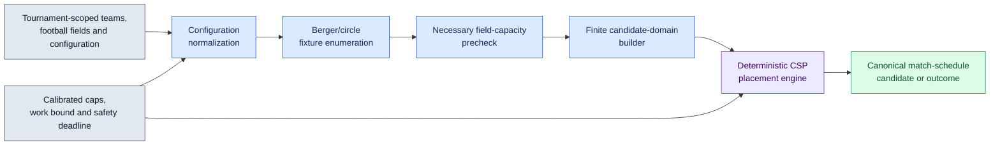
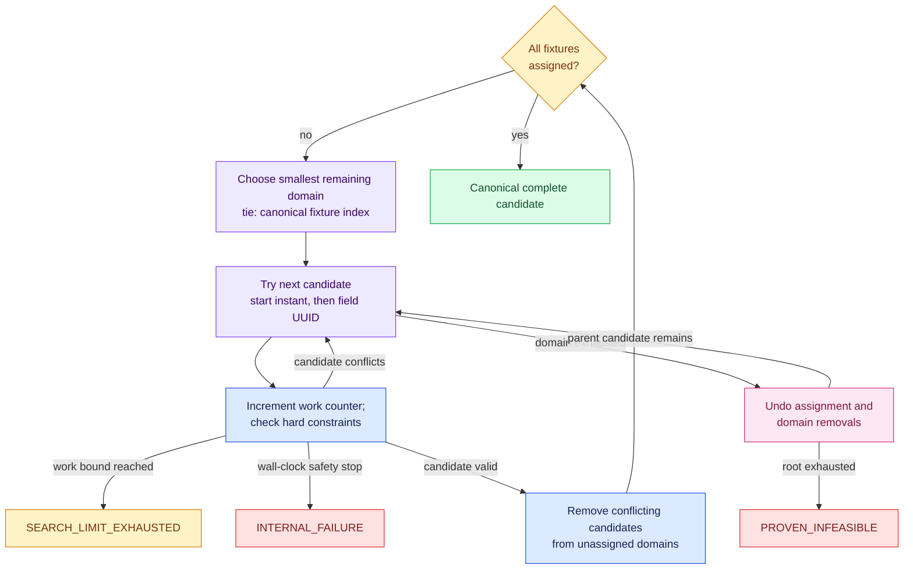

# TQ-001 — Fixture and Placement Strategy Design

The API builds exact fixtures and places them with a deterministic, Spring- and JPA-free constraint search.

## Component boundary



| Component | Input | Responsibility | Output |
| --- | --- | --- | --- |
| Configuration normalization | Tournament-owned team and football-field IDs, dates, daily window, IANA `ZoneId`, match duration and minimum rest | Validate semantic input, resolve local windows, normalize instants to PostgreSQL microsecond precision and enforce calibrated finite-domain caps | Immutable normalized configuration or `INVALID_CONFIGURATION` |
| Fixture enumeration | Teams sorted by stable UUID order | Apply the Berger/circle rotation, add one internal bye for an odd count and omit every bye pairing | Canonically indexed unordered team pairs |
| Capacity precheck | Fixture count, daily windows, selected football fields, duration | Calculate a necessary field-capacity bound before search | Continue or `INSUFFICIENT_THEORETICAL_CAPACITY` |
| Candidate-domain builder | Normalized windows, football fields and fixtures | Generate every legal whole-minute start and football-field assignment whose match end remains inside one daily window | Finite ordered domain per fixture |
| Placement engine | Fixtures, domains, rest and turnaround rules, calibrated execution policy | Search with stable MRV selection, forward checking and reversible assignments | Complete candidate, `PROVEN_INFEASIBLE`, `SEARCH_LIMIT_EXHAUSTED` or `INTERNAL_FAILURE` |

The application layer supplies calibrated policy values to this boundary. Domain components do not read Spring configuration, persistence state or environment variables.

## Normalized finite domain

One normalized configuration defines the complete search space.

| Rule | Contract |
| --- | --- |
| Team count | Include 2–12 distinct tournament-owned teams. |
| Football fields | Include at least one distinct tournament-owned football field. |
| Dates and window | Use an inclusive tournament date range and one forward daily local-time window. |
| Time zone | Resolve each local boundary with the supplied IANA `ZoneId`; reject a gap or ambiguous local date-time instead of selecting an offset. |
| Duration and rest | Use whole minutes; duration is positive and minimum rest is non-negative. |
| Candidate grid | Start on each whole minute inside a resolved window; retain a candidate only when `start + duration <= window end`. |
| Domain caps | Reject input that exceeds the calibrated date-span, football-field or total-candidate cap. |
| Stable order | Order teams, football fields and fixture keys by the same defined UUID comparison; order candidates by start instant and then football-field UUID. |

The prerequisite calibration unit in [Efforts](Efforts.md) fixes the quantitative caps, deterministic work budget, wall-clock safety deadline and benchmark threshold before generator implementation starts.

## Exact fixture construction

The enumerator emits every unordered real-team pair exactly once.

1. Sort teams by stable UUID order.
2. Add one internal bye when the count is odd.
3. Hold one position fixed and rotate the remaining positions for `N - 1` rounds, where `N` includes the bye.
4. Emit each round in canonical position order.
5. Drop a pairing containing the bye.
6. Assert a result size of `realTeamCount × (realTeamCount - 1) / 2` and a unique canonical key for every pair.

The internal bye is not a team, fixture or match-schedule entry.

## Necessary capacity precheck

The precheck rejects only configurations whose football fields cannot hold the required match count even before team constraints apply.

For one football field on one playing date, let `W` be the window length in minutes, `D` the match duration and `T = 5` the fixed turnaround:

```text
slots(W, D) = 0                                  when W < D
slots(W, D) = 1 + floor((W - D) / (D + T))      when W >= D
```

Sum `slots(W, D)` across all selected football fields and playing dates. A total below the fixture count returns `INSUFFICIENT_THEORETICAL_CAPACITY`. A passing result proves only that aggregate football-field capacity is sufficient; team overlap, minimum rest and candidate interaction can still make the finite model infeasible.

## Deterministic placement

The search explores the finite candidate tree in one reproducible order.



One candidate attempt is one deterministic work unit. The engine checks the work bound before evaluating that candidate. The wall-clock deadline is separate operational protection: reaching it returns `INTERNAL_FAILURE`, never `SEARCH_LIMIT_EXHAUSTED` or `PROVEN_INFEASIBLE`.

Forward checking removes a candidate when it conflicts with an assigned fixture through a shared team, a shared football field, minimum rest or five-minute turnaround. Team separation compares the earlier match end with the later match start. An empty unassigned domain triggers backtracking. Exhausting the root domain without hitting either bound proves infeasibility only for the complete normalized finite domain.

## Output contract

A successful placement contains exactly one assignment per fixture. Sort the result by start instant, end instant, canonical fixture key and football-field UUID before returning it to the independent validator.

| Outcome | Condition |
| --- | --- |
| Candidate match schedule | Every fixture has one assignment and all generator-side hard checks pass. |
| `INVALID_CONFIGURATION` | Semantic input, time resolution or a calibrated finite-domain cap fails. |
| `INSUFFICIENT_THEORETICAL_CAPACITY` | The necessary aggregate football-field bound is below the fixture count. |
| `PROVEN_INFEASIBLE` | The engine exhausts the complete normalized candidate tree. |
| `SEARCH_LIMIT_EXHAUSTED` | The deterministic candidate-attempt budget is reached without a candidate or proof. |
| `INTERNAL_FAILURE` | The wall-clock safety stop, an invariant breach or an unexpected runtime failure ends generation. |

The independent validator remains the authority for preview validity. It can convert a generator candidate into `INTERNAL_FAILURE`; generator checks do not replace that boundary.

## Persistence and compatibility

This design adds no table, column, index, dependency, secret or external configuration service. The generator returns values only and cannot persist a match schedule. The existing manual match endpoint does not invoke fixture enumeration or placement.

The integrated flow and REST boundary are defined in [Architecture](Architecture.md). The option decision and rejected alternatives remain in [Evaluate](<../design/02 Evaluate - Fixture and Placement Strategy.md>).

## Verification obligations

| Scenario | Expected evidence |
| --- | --- |
| Two teams | One real fixture and no bye entry. |
| Three teams | Three unique real fixtures across the odd-team rotation and no bye entry. |
| Twelve teams | Sixty-six unique unordered fixtures. |
| Deterministic replay | Repeated normalized input produces byte-equivalent ordered assignments within one application version. |
| Feasible constrained placement | Every assignment stays inside its window and satisfies team overlap, football-field overlap, five-minute turnaround and end-to-start minimum rest. |
| Non-chronological conflict shape | A candidate earlier than an existing assignment is checked against both chronological neighbours. |
| Complete finite exhaustion | An impossible bounded model returns `PROVEN_INFEASIBLE` only after the root domain is exhausted. |
| Deterministic work bound | The same candidate-attempt limit reaches `SEARCH_LIMIT_EXHAUSTED` at the same search point. |
| Wall-clock safety stop | An injected safety-stop signal returns `INTERNAL_FAILURE` and never an infeasibility or exhaustion claim. |
| Capacity bound | Each formula branch and the summed field-day total classify only mathematically insufficient configurations. |
| Daylight-saving transition | A local gap or overlap returns `INVALID_CONFIGURATION`; no implicit offset is selected. |
| Independent validation handoff | Every successful candidate is submitted to the separate whole-match-schedule validator before preview. |
