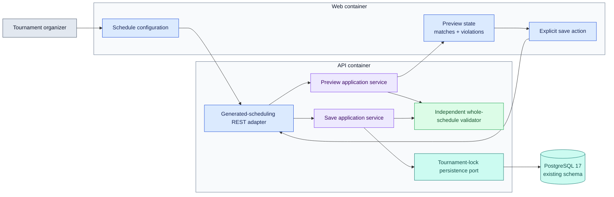
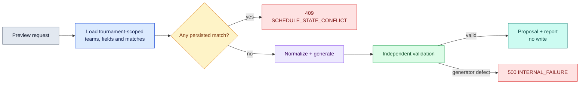
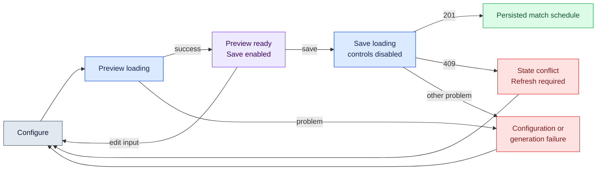

# TQ-001 — Preview and Persistence Protocol Design

Generated scheduling uses a read-only preview followed by an explicit, tournament-locked save that inserts the complete match schedule in one transaction.

## Component contracts



| Component | Responsibility | Contract |
| --- | --- | --- |
| Generated-scheduling REST adapter | Validate HTTP shape and map application outcomes to Problem Details. | Adds `POST /schedule/preview` and `POST /schedule` below the existing tournament resource. |
| Preview application service | Load current tournament state, reject a nonempty match schedule, generate and independently validate a proposal. | Performs no write and opens no persistence lifecycle for the preview. |
| Save application service | Serialize the tournament write, reload current state, validate the submitted proposal and persist it atomically. | Owns one outer Spring transaction for lock, reload, validation and every match insert. |
| Tournament-lock persistence port | Acquire the tournament row with a pessimistic write lock. | Every schedule-invalidating writer calls this port before scoped reads or writes. |
| Web generated-scheduling state | Hold configuration and the returned proposal until save or refresh. | Preserves the Problem Details `code` and the ordered violation array. |

The scheduling domain and validator remain Spring- and JPA-free. The application services adapt tournament records into their immutable inputs.

## REST payloads

The preview request schedules every currently registered team on a selected subset of registered football fields.

| Configuration field | JSON form | Rule |
| --- | --- | --- |
| First tournament date | `startDate: YYYY-MM-DD` | Inclusive local date. |
| Last tournament date | `endDate: YYYY-MM-DD` | Inclusive and not before `startDate`. |
| Daily playing window | `dailyStart: HH:mm`, `dailyEnd: HH:mm` | Local times on each included date; every match must end at or before `dailyEnd`. |
| Scheduling time zone | `zoneId: string` | IANA identifier; daylight-saving gaps and ambiguous local times are rejected. |
| Football fields | `fieldIds: UUID[]` | Nonempty, distinct and tournament-owned; normalized in UUID order. |
| Match duration | `matchDurationMinutes: integer` | Positive whole minutes. |
| Minimum team rest | `minimumRestMinutes: integer` | Nonnegative whole minutes, measured from match end to the team's next match start. |

`POST /api/tournaments/{tournamentId}/schedule/preview` returns:

| Member | Content |
| --- | --- |
| `configuration` | The normalized request, including canonically ordered football field IDs. |
| `registeredTeamIds` | The canonically ordered team snapshot used to enumerate fixtures. |
| `matches` | Canonically ordered `homeTeamId`, `awayTeamId`, `fieldId`, `startsAt` and `endsAt` values. Preview matches have no persisted match ID. |
| `validation` | `valid` plus the stable ordered violation array defined by the validation design. A successful generated preview is valid. |

`POST /api/tournaments/{tournamentId}/schedule` resubmits the complete preview response as its save request. The API does not require or issue a preview token. The success response contains the persisted match schedule, including generated match IDs, in chronological order.

The full request and response model is additive. `GET /schedule` and the existing manual `POST /matches` payloads do not change.

## Preview flow

Preview confirms that generation is currently eligible before it spends search work.



A concurrent registration or manual match can complete after the preview read. Preview remains side-effect free; save detects that state change under the tournament lock.

## Atomic save and shared lock protocol

Save acquires the tournament row before it reads state used by the transaction.

```mermaid
sequenceDiagram
    participant W as Web
    participant A as Save service
    participant D as PostgreSQL
    participant V as Independent validator

    W->>A: POST /schedule (configuration + complete proposal)
    A->>D: BEGIN; SELECT tournament FOR UPDATE
    D-->>A: Tournament lock acquired
    A->>D: Reload teams, selected fields and matches
    alt Existing match or relevant state changed
        A-->>D: ROLLBACK
        A-->>W: 409 SCHEDULE_STATE_CONFLICT
    else State matches submitted context
        A->>V: Validate complete proposal
        alt Invalid submitted proposal
            V-->>A: Ordered violations
            A-->>D: ROLLBACK
            A-->>W: 400 SCHEDULE_INVALID
        else Valid proposal
            A->>D: Insert all match rows
            alt Insert or commit fails
                A-->>D: ROLLBACK all rows
                A-->>W: Mapped failure Problem Details
            else Commit succeeds
                D-->>A: Persisted match schedule
                A-->>W: 201 Created
            end
        end
    end
```

The transaction sequence is fixed:

1. Acquire the tournament row with a pessimistic write lock.
2. Reload all registered teams, selected football fields and persisted matches.
3. Return `SCHEDULE_STATE_CONFLICT` when a match exists, the registered-team snapshot differs, or a selected football field is no longer tournament-owned.
4. Independently validate the complete resubmitted proposal against the reloaded state and configuration.
5. Insert every match through the existing match persistence model.
6. Commit once; every exception before commit rolls back the complete batch.

The API does not retry lock timeouts or deadlocks inside the request. Their calibrated timeout bounds the request, and the Web refreshes state before the organizer retries.

| Writer | Required lock order | External compatibility |
| --- | --- | --- |
| Generated match-schedule save | Tournament row → teams and selected football fields → matches → batch insert | New additive operation. |
| Manual `POST /matches` | Tournament row → referenced teams and football field → existing create flow | Request, response and current manual validation semantics stay unchanged. |
| Team registration | Tournament row → team insert | Existing registration contract stays unchanged. |
| Football field registration | Tournament row → football field insert | Existing registration contract stays unchanged. |

Each transaction locks one tournament. No writer acquires scoped rows before its tournament row.

## Failure and recovery contract

Every state conflict uses HTTP `409` and top-level code `SCHEDULE_STATE_CONFLICT`; the stable `reason` identifies recovery behavior.

| Condition | HTTP / Problem code | Reason or violation | Recovery |
| --- | --- | --- | --- |
| Preview or save finds an existing match | `409 SCHEDULE_STATE_CONFLICT` | `MATCH_SCHEDULE_EXISTS` | Reload the workspace; generated scheduling remains unavailable while matches exist. |
| Registered-team snapshot or selected football-field ownership changed | `409 SCHEDULE_STATE_CONFLICT` | `TOURNAMENT_STATE_CHANGED` | Reload registrations and create a new preview. |
| Tournament lock exceeds the calibrated wait bound | `409 SCHEDULE_STATE_CONFLICT` | `LOCK_TIMEOUT` | Reload and retry through a new organizer action. |
| PostgreSQL aborts a deadlocked transaction | `409 SCHEDULE_STATE_CONFLICT` | `DEADLOCK` | Reload and retry through a new organizer action. |
| Resubmitted proposal violates schedule rules | `400 SCHEDULE_INVALID` | Ordered validation violations | Keep configuration editable; create a new preview before saving. |
| Persistence violates an internal invariant | `500 INTERNAL_FAILURE` | Sanitized detail | No match row remains from the failed batch. |

The lock-wait threshold is a versioned application constant produced by the prerequisite calibration work in [Efforts](Efforts.md). It is applied consistently in local and Docker Compose execution.

## Web states

The Web exposes save only for the currently displayed successful preview.



Editing configuration invalidates the displayed proposal and disables save. The client keeps every structured violation, including repeated codes for the same football field or fixture, instead of reducing them to one message per field.

## Persistence and configuration impact

The selected protocol adds no table, column, index or Flyway migration. PostgreSQL 17 supplies the row lock and existing transaction rollback. Spring transaction and JPA lock facilities already belong to the API stack; no new dependency, service, secret or deployment unit is introduced.

The calibrated lock wait is non-secret runtime configuration with one checked-in local default. Unsupported or missing values fail API startup rather than allowing an unbounded wait.

## Verification obligations

| Level | Evidence |
| --- | --- |
| API contract | Preview and save request/response serialization; stable Problem Details code, reason and ordered violations; unchanged manual endpoint contract. |
| Preview integration | PostgreSQL row counts are identical before and after success, invalid input, infeasibility, exhaustion and internal failure; an existing match returns `409` before generation. |
| Atomic persistence | A valid 1–66 match proposal commits completely; injected validation, insert and commit failures leave zero new matches. |
| Concurrent generated saves | Two saves for one empty tournament produce one complete winner and one `409`; no combined or duplicate schedule appears. |
| Manual-write race | Generated save racing manual `POST /matches` produces one serialized winner; the loser observes state conflict without partial rows. |
| Registration races | Generated save racing team or football field registration follows tournament-first locking; saved fixtures match the state reloaded under the lock. |
| Lock failures | Testcontainers forces lock timeout and deadlock translation to the stable `409` reasons and verifies complete rollback. |
| Web behavior | Configuration edits invalidate preview; loading disables duplicate actions; success renders the persisted match schedule; conflict requires refresh; repeated violations and top-level codes remain available. |

The integrated container flow is authoritative in [Architecture](Architecture.md). The selection record and tradeoffs remain in [Preview and Persistence Protocol Evaluate](<../design/02 Evaluate - Preview and Persistence Protocol.md>).
