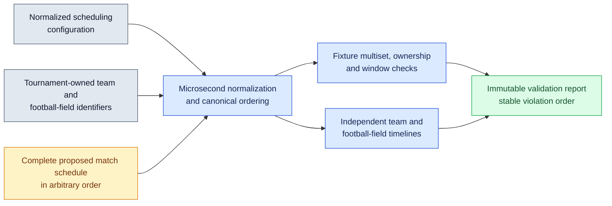

# TQ-001 — Validation and Failure Model Design

The scheduling feature validates every complete proposed match schedule as untrusted input before preview delivery and before persistence.

## Component boundary

| Component | Input | Responsibility | Output |
| --- | --- | --- | --- |
| Whole-match-schedule validator | Normalized configuration, tournament-owned IDs and complete proposal | Evaluate every hard constraint without reading generator search state or persistence | Immutable validation report |
| Canonical normalizer | Proposal in any order | Normalize instants to PostgreSQL microsecond precision and build stable match and fixture keys | Canonical matches and resource timelines |
| Fixture validator | Canonical matches and expected team set | Check ownership, distinct teams, duration and exact single round-robin fixture multiset | Fixture and ownership violations |
| Temporal validator | Canonical matches and resolved daily windows | Check windows, overlaps, end-to-start team rest and five-minute football-field turnaround | Time and resource violations |
| Failure mapper | Generation outcome, validation report or persistence conflict | Produce the stable Problem Details outcome and HTTP status | REST error contract |

The validator is plain Java domain logic inside the scheduling feature. It shares immutable configuration, match value types and timestamp normalization with generation. It does not share generator constraint predicates, candidate domains, mutable assignments or search state.

## Canonical input model

Validation gives the same report for every permutation of the same proposal.

| Value | Canonical rule |
| --- | --- |
| Instant | Truncate to PostgreSQL microsecond precision before comparison. |
| UUID | Compare by one project-owned unsigned hexadecimal representation. |
| Fixture key | Order the two team UUIDs, then encode `(lowerTeamId, higherTeamId)`. |
| Complete match order | Sort by `startsAt`, `endsAt`, fixture key and football-field UUID. |
| Team timeline | Group by team UUID and apply the complete match order. |
| Football-field timeline | Group by football-field UUID and apply the complete match order. |
| Match path | Assign `matches/{canonicalOrdinal}` after canonical sorting; request array position has no meaning. |

The expected fixture multiset contains every unordered pair from the registered team set exactly once. Its size is `N × (N − 1) / 2`. A missing, duplicate or unexpected pair is reported independently; the validator never infers completeness from match count alone.

## Constraint evaluation

Every check runs over the normalized complete proposal, so insertion order cannot hide a predecessor, successor or conflicting interval.

| Rule | Evaluation |
| --- | --- |
| Ownership | Every team and football-field UUID exists in the tournament-owned input sets. |
| Participants | Home and away team UUIDs differ. |
| Interval | `endsAt` is strictly after `startsAt`, and duration equals the configured match duration. |
| Playing window | The complete interval falls inside one resolved daily window within the configured tournament dates. |
| Fixture set | Compare the actual canonical fixture multiset with the expected multiset. |
| Team overlap | Compare every interval pair in each team timeline and report each overlap. |
| Team rest | For each chronologically adjacent pair, require `next.startsAt >= previous.endsAt + minimumRest`. An overlap also produces a rest violation when this inequality fails. |
| Football-field overlap | Compare every interval pair in each football-field timeline and report each overlap. |
| Football-field turnaround | For each chronologically adjacent pair, require `next.startsAt >= previous.endsAt + 5 minutes`. An overlap also produces a turnaround violation when this inequality fails. |

Window boundaries are resolved from the confirmed IANA `ZoneId` before validation. A daylight-saving gap or ambiguous local time makes the configuration invalid; the validator never selects an offset silently.

## Violation contract

The validation report contains `valid` and an immutable ordered `violations` list. A violation contains `code`, `path` and the applicable references from this set: `fixtureKey`, `relatedFixtureKey`, `teamId`, `fieldId`, `startsAt`, `endsAt` and scalar `parameters`. Absent references are omitted from JSON.

Violation codes have the stable ordinal below. Reports sort by ordinal, fixture key, related fixture key, team UUID, football-field UUID, start instant, end instant and path. Null values sort last. This total order is part of the REST contract.

| Ordinal | Code | Meaning |
| ---: | --- | --- |
| 1 | `UNKNOWN_TEAM` | A participant does not belong to the tournament. |
| 2 | `UNKNOWN_FIELD` | The football field does not belong to the tournament. |
| 3 | `SELF_MATCH` | Both participant UUIDs are equal. |
| 4 | `INVALID_INTERVAL` | The end is not after the start. |
| 5 | `WRONG_DURATION` | The interval does not equal the configured match duration. |
| 6 | `OUTSIDE_PLAYING_WINDOW` | The interval is outside configured dates or a resolved daily window. |
| 7 | `DUPLICATE_FIXTURE` | The actual multiset contains the same unordered pair more than once. |
| 8 | `MISSING_FIXTURE` | The expected multiset contains a pair absent from the proposal. |
| 9 | `UNEXPECTED_FIXTURE` | The proposal contains a pair outside the expected multiset. |
| 10 | `TEAM_OVERLAP` | Two matches for one team overlap. |
| 11 | `TEAM_REST_VIOLATION` | End-to-start time between adjacent team matches is below minimum rest. |
| 12 | `FIELD_OVERLAP` | Two matches on one football field overlap. |
| 13 | `FIELD_TURNAROUND_VIOLATION` | End-to-start time between adjacent football-field uses is below five minutes. |

The Web preserves repeated violations and their codes. It does not reduce the list to one message per field.

## Failure mapping

Generation outcomes and validation violations are separate contracts.

| Outcome | HTTP | Response rule |
| --- | ---: | --- |
| `INVALID_CONFIGURATION` | 400 | Problem Details contains field errors; search does not start. |
| `SCHEDULE_INVALID` | 400 | Problem Details contains the complete deterministic violation list for a submitted proposal. |
| `SCHEDULE_STATE_CONFLICT` | 409 | Existing matches, concurrent state, lock timeout or deadlock requires refresh before retry. |
| `INSUFFICIENT_THEORETICAL_CAPACITY` | 422 | A documented necessary lower bound fails; no infeasibility proof is claimed. |
| `PROVEN_INFEASIBLE` | 422 | The generator exhausted the complete configured finite candidate tree. |
| `SEARCH_LIMIT_EXHAUSTED` | 422 | Deterministic work units reached their configured limit without a result or proof. |
| `INTERNAL_FAILURE` | 500 | The response is sanitized and does not expose an exception, SQL detail or search state. |

A server-generated proposal rejected by the independent validator is `INTERNAL_FAILURE`. A resubmitted save proposal altered into an invalid match schedule is `SCHEDULE_INVALID`. A wall-clock safety stop is non-deterministic operational protection and maps to `INTERNAL_FAILURE`, never `SEARCH_LIMIT_EXHAUSTED` or `PROVEN_INFEASIBLE`.

## Verification obligations

The validator is verified without Spring, JPA or PostgreSQL; API mapping and persistence precision receive integration coverage.

| Evidence | Required cases |
| --- | --- |
| Rule unit tests | One positive and one negative case for every violation code. |
| Permutation tests | Random permutations of one proposal return byte-equivalent ordered violations. |
| Predecessor and successor tests | Insert a later match first, then an earlier match; overlap, rest and turnaround results stay unchanged. |
| Fixture mutation tests | Remove, duplicate, swap and introduce a foreign fixture; expected multiset violations remain exact. |
| Temporal mutation tests | Move starts and ends across overlap, rest, turnaround, duration and daily-window boundaries. |
| Report tests | Preserve multiple violations for one match, team and football field in the stable total order. |
| Maximum-size tests | Validate all 66 matches and their resource timelines within the calibrated execution budget. |
| API contract tests | Assert status, outcome code, violation fields and sanitized `INTERNAL_FAILURE`. |
| PostgreSQL integration tests | Round-trip microsecond-normalized instants and confirm validation agrees before and after persistence. |

This design adds no table, column, index, dependency, configuration secret or runtime service. The integrated flow is defined in [Architecture](Architecture.md), and the selection record remains in [Validation and Failure Model Evaluate](<../design/02 Evaluate - Validation and Failure Model.md>).
