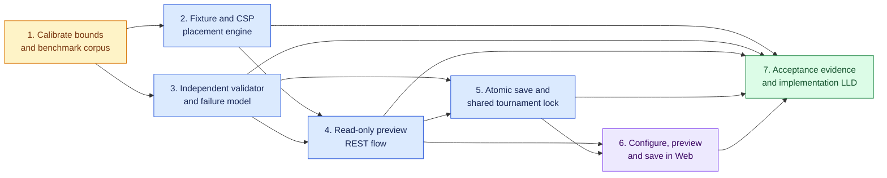

# TQ-001 — Constraint-Based Round-Robin Schedule Generation Efforts

The implementation starts with measured calibration, builds the independent domain components in parallel, and joins them through preview, atomic save and Web delivery.

## Delivery sequence

The calibration result is versioned evidence for the implementation constants. Units 2 and 3 then proceed in parallel; preview joins both components before persistence and Web delivery.

## Work breakdown

| # | Summary | Type | Layer | Depends on | Completion evidence |
| --- | --- | --- | --- | --- | --- |
| 1 | Calibrate the maximum date span, daily-window size, football-field count, candidate-count cap, deterministic candidate-attempt budget, wall-clock safety deadline and tournament-lock timeout against a representative benchmark corpus; record the pass threshold and measured results. | spike | Cross-cutting | — | A versioned calibration record fixes every constant, scenario and pass threshold used by later units. |
| 2 | Implement pure Java configuration normalization, exact Berger fixtures, finite candidates, theoretical-capacity check and deterministic CSP placement, including unit coverage for even and odd team counts, replay and every search outcome. | feat | API domain | 1 | Unit tests prove exact fixture counts for 2–12 teams, hard-constraint placement, deterministic replay and distinct infeasibility, deterministic exhaustion and safety-stop outcomes. |
| 3 | Implement the independent whole-match-schedule validator, stable structured violations and failure mapping, including permutation and mutation tests. | feat | API domain and REST errors | 1 | Tests preserve identical ordered violations for arbitrary input order, detect predecessor and successor conflicts, and cover every violation and outcome code. |
| 4 | Implement the read-only generated-schedule preview application flow and REST contract, including empty-match-schedule enforcement and API contract tests. | feat | API application and REST | 2, 3 | Preview returns canonical proposed matches and validation results, writes no rows, and returns the specified Problem Details outcomes. |
| 5 | Implement atomic generated save and tournament-first locking for generated save, manual match creation and relevant team or football-field registration writes; add conflict mapping, Testcontainers races and rollback tests. | feat | API persistence | 3, 4 | Concurrent generated, manual and registration writes serialize on one tournament; one winner commits, conflicts return `409`, and injected failures leave no partial match schedule. |
| 6 | Implement the React and TypeScript configuration, preview and explicit-save flow with structured Problem Details states and UI tests. | feat | Web | 4, 5 | Web tests cover configuration, loading, preview, explicit save, successful refresh, state-conflict recovery and repeated actionable violations. |
| 7 | Produce end-to-end acceptance evidence with deterministic replay at calibrated bounds, `docker compose up --build` smoke verification and implementation-grounded LLD updates. | chore | Cross-cutting | 2, 3, 4, 5, 6 | Backend and Web checks pass, the three-service Compose topology completes the generated scheduling flow, and the LLD reflects verified implementation behavior. |

The component contracts are authoritative in [Fixture and Placement Strategy](<Design - Fixture and Placement Strategy.md>), [Validation and Failure Model](<Design - Validation and Failure Model.md>) and [Preview and Persistence Protocol](<Design - Preview and Persistence Protocol.md>). [Architecture](Architecture.md) owns the end-to-end boundary and [Stack](Stack.md) owns the technology constraints.

## Rollout and rollback

The rollout adds two REST operations and the matching Web interaction while preserving the existing schema and manual endpoint contracts. API and Web changes deploy together after units 1–6 pass their completion evidence. No data migration, backfill, external service or new runtime unit is required.

Rollback removes the generated preview/save endpoints, Web interaction and shared-lock coordination in one application rollback. Existing match rows remain readable through the baseline match-schedule endpoint, and no database rollback is required.

## Effort estimate

The developer supplies estimates during Solution sign-off.

| # | Description | Estimate |
| --- | --- | --- |
| 1 | Calibrate execution and lock bounds | 0.5d |
| 2 | Implement fixture and CSP placement engine | 2d |
| 3 | Implement independent validator and failure model | 1.5d |
| 4 | Implement read-only preview REST flow | 1d |
| 5 | Implement atomic save and shared tournament locking | 2d |
| 6 | Implement Web configure, preview and save flow | 2d |
| 7 | Complete acceptance evidence and implementation LLD | 1d |
| **Total** |  | **10d** |
