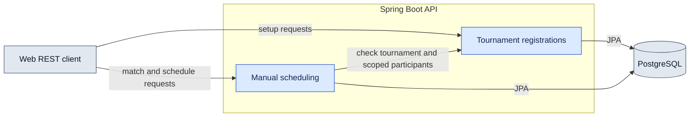

# API component overview

The feature packages partition [registrations](<Tournament Registrations.md>) and [manual scheduling](<Manual Scheduling.md>). [Principles and Patterns](<Principles and Patterns.md>) covers shared error, transaction and migration boundaries.
