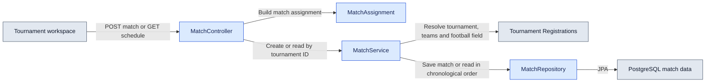

# Manual Scheduling

Manual Scheduling records an explicitly submitted match and returns the stored match schedule for one tournament. [API overview](00%20Overview.md)

## HTTP contracts

| Endpoint | Input | Success |
| --- | --- | --- |
| `POST /api/tournaments/{tournamentId}/matches` | Tournament UUID in the path, three required UUIDs in the body (`homeTeamId`, `awayTeamId`, `fieldId`), and `startsAt` and `endsAt` as date-times with offsets | `201` with the scheduled match |
| `GET /api/tournaments/{tournamentId}/schedule` | Tournament UUID in the path | `200` with an array ordered by start time and then match ID. An existing tournament with zero matches returns an empty array. |

Each match contains its UUID, home team, away team, football field and two ISO-formatted UTC timestamps. Each team and football field is represented by its UUID and name. [MatchController](../../../backend/src/main/java/com/artisyn/tournamentiq/match/api/MatchController.java) · [MatchService](../../../backend/src/main/java/com/artisyn/tournamentiq/match/application/MatchService.java) · [Jackson configuration](../../../backend/src/main/resources/application.yml)

## Create a match

1. `MatchController` validates the request and converts both offsets to instants. `MatchAssignment` rejects identical teams, truncates both instants to PostgreSQL microsecond precision and requires the truncated end to follow the truncated start. [MatchController](../../../backend/src/main/java/com/artisyn/tournamentiq/match/api/MatchController.java) · [MatchAssignment](../../../backend/src/main/java/com/artisyn/tournamentiq/match/domain/MatchAssignment.java)
2. Within a write transaction, `MatchService` verifies that the tournament exists. It resolves both teams and the football field using the supplied tournament UUID and each requested entity UUID. [MatchService](../../../backend/src/main/java/com/artisyn/tournamentiq/match/application/MatchService.java) · [Tournament Registrations](Tournament%20Registrations.md)
3. The service saves a `MatchEntity` through JPA and maps the persisted assignment to `ScheduledMatch`. The database enforces tournament-scoped foreign keys, distinct teams and end after start. [MatchEntity](../../../backend/src/main/java/com/artisyn/tournamentiq/match/persistence/MatchEntity.java) · [Flyway schema](../../../backend/src/main/resources/db/migration/V1__create_tournament_schema.sql)

## Read the match schedule

`MatchService` checks the tournament and fetches its matches in a read-only transaction. `MatchRepository` orders by `startsAt` and `id` and includes the home team, away team and football field in its entity graph so the service can map their names. PostgreSQL indexes the tournament, start time and ID in that order. [MatchService](../../../backend/src/main/java/com/artisyn/tournamentiq/match/application/MatchService.java) · [MatchRepository](../../../backend/src/main/java/com/artisyn/tournamentiq/match/persistence/MatchRepository.java) · [Schedule index](../../../backend/src/main/resources/db/migration/V1__create_tournament_schema.sql)

## Failures and verification

| Condition | Result |
| --- | --- |
| A create field is missing, both teams are the same, the time interval is invalid, or a team or football field lookup fails within the tournament | `400 VALIDATION_FAILED` with an `errors` entry for the applicable request field |
| The create body is unreadable | `400 INVALID_REQUEST` |
| The tournament does not exist when the service checks it | `404 TOURNAMENT_NOT_FOUND` |

See the shared [API principles and patterns](Principles%20and%20Patterns.md) and [ApiErrors](../../../backend/src/main/java/com/artisyn/tournamentiq/shared/api/ApiErrors.java) for the Problem Details response.

Run `./mvnw test` from `backend/` with Java 21 and Docker to verify this path. The domain unit tests cover identical teams and invalid intervals, including sub-microsecond intervals that truncate to equality. The PostgreSQL integration tests cover creation, offset normalization, chronological reads, tournament ownership and field-level errors. [MatchAssignmentTest](../../../backend/src/test/java/com/artisyn/tournamentiq/match/domain/MatchAssignmentTest.java) · [TournamentApiIntegrationTest](../../../backend/src/test/java/com/artisyn/tournamentiq/TournamentApiIntegrationTest.java)
