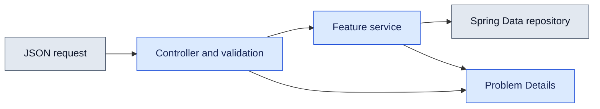

# API principles and patterns

| Concern | Existing implementation | Evidence |
| --- | --- | --- |
| Validation | Required inputs are validated in the controller path. Cross-resource checks run in feature services. | [MatchController](../../../backend/src/main/java/com/artisyn/tournamentiq/match/api/MatchController.java), [MatchService](../../../backend/src/main/java/com/artisyn/tournamentiq/match/application/MatchService.java) |
| Errors | Problem Details carries a machine code and optional field violations. The application logs unexpected failures and returns a generic message. | [ApiErrors](../../../backend/src/main/java/com/artisyn/tournamentiq/shared/api/ApiErrors.java) |
| Transactions | List queries are read-only. Mutating operations run in write transactions. | [TournamentService](../../../backend/src/main/java/com/artisyn/tournamentiq/tournament/application/TournamentService.java), [MatchService](../../../backend/src/main/java/com/artisyn/tournamentiq/match/application/MatchService.java) |
| Time | HTTP timestamps use offsets, JVM match times use instants, database columns use timestamptz. | MatchController, [MatchAssignment](../../../backend/src/main/java/com/artisyn/tournamentiq/match/domain/MatchAssignment.java) and schema |
