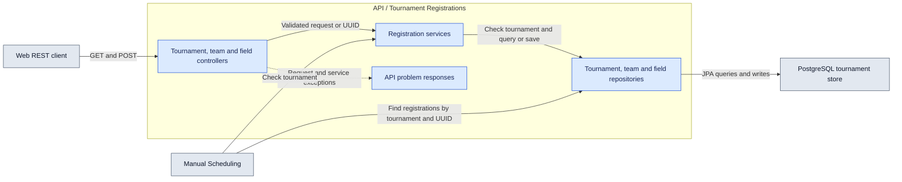

# Tournament Registrations

This component owns tournament creation and lookup and the team and football field registrations within each tournament. It gives [Manual Scheduling](<Manual Scheduling.md>) tournament existence checks and scoped participant lookups. See the [API component overview](<00 Overview.md>) for the container boundary.

## REST contracts

All successful responses contain summaries with a UUID `id` and a display `name`. List responses are arrays sorted by ascending name, then ascending ID.

| Endpoint | Read | Write |
| --- | --- | --- |
| [`/api/tournaments`](../../../backend/src/main/java/com/artisyn/tournamentiq/tournament/api/TournamentController.java#L19) | GET returns all tournament summaries | POST creates a tournament and returns 201 with its summary and a `Location` header |
| [`/api/tournaments/{id}`](../../../backend/src/main/java/com/artisyn/tournamentiq/tournament/api/TournamentController.java#L33) | GET returns one tournament summary | |
| [`/api/tournaments/{tournamentId}/teams`](../../../backend/src/main/java/com/artisyn/tournamentiq/team/api/TeamController.java#L19) | GET lists team registrations for the tournament | POST registers a team and returns 201 with its summary |
| [`/api/tournaments/{tournamentId}/fields`](../../../backend/src/main/java/com/artisyn/tournamentiq/field/api/FieldController.java#L19) | GET lists football field registrations for the tournament | POST registers a football field and returns 201 with its summary |

## Registration flow

1. The controller parses the UUID path value where applicable. For POST, Bean Validation checks that the [JSON `name` field](../../../backend/src/main/java/com/artisyn/tournamentiq/shared/api/NameRequest.java#L6) is nonblank and at most 120 characters before the service strips surrounding whitespace.
2. The [team service](../../../backend/src/main/java/com/artisyn/tournamentiq/team/application/TeamService.java#L23) and the [football field service](../../../backend/src/main/java/com/artisyn/tournamentiq/field/application/FieldService.java#L23) require the parent tournament for both reads and writes. The [tournament service](../../../backend/src/main/java/com/artisyn/tournamentiq/tournament/application/TournamentService.java#L21) owns that check and saves new tournaments. Reads run in read-only transactions and writes run in write transactions.
3. Spring Data JPA saves each registration with its generated UUID and the parent tournament ID. The [database schema](../../../backend/src/main/resources/db/migration/V1__create_tournament_schema.sql#L1) enforces both parent foreign keys and the name constraints. Identity is the UUID, and repeated display names can have separate records.
4. The [team](../../../backend/src/main/java/com/artisyn/tournamentiq/team/persistence/TeamRepository.java#L9) and [football field](../../../backend/src/main/java/com/artisyn/tournamentiq/field/persistence/FieldRepository.java#L9) repositories filter list queries by tournament ID. [Match creation](../../../backend/src/main/java/com/artisyn/tournamentiq/match/application/MatchService.java#L42) uses the same repositories to look up each participant by tournament ID and resource ID.

## Failure behavior

[`ApiErrors`](../../../backend/src/main/java/com/artisyn/tournamentiq/shared/api/ApiErrors.java#L21) emits Problem Details with a machine-readable `code`. The API uses the shared [Principles and Patterns](<Principles and Patterns.md>) for error mapping and transaction boundaries.

| Condition | Status | Code |
| --- | --- | --- |
| Tournament UUID does not identify an existing tournament | 404 | `TOURNAMENT_NOT_FOUND` |
| Name fails Bean Validation | 400 | `VALIDATION_FAILED` with a field entry in `errors` |
| Body is malformed or missing | 400 | `INVALID_REQUEST` |
| Path UUID is malformed | 400 | `HTTP_400` |
| An unexpected exception reaches the API handler | 500 | `INTERNAL_ERROR` |

The [PostgreSQL integration suite](../../../backend/src/test/java/com/artisyn/tournamentiq/TournamentApiIntegrationTest.java#L48) exercises creation, the normalized name and `Location`, retrieving the tournament, and registering and listing teams and football fields. Separate [failure cases](../../../backend/src/test/java/com/artisyn/tournamentiq/TournamentApiIntegrationTest.java#L120) assert error codes for blank names, malformed JSON and invalid UUIDs.
