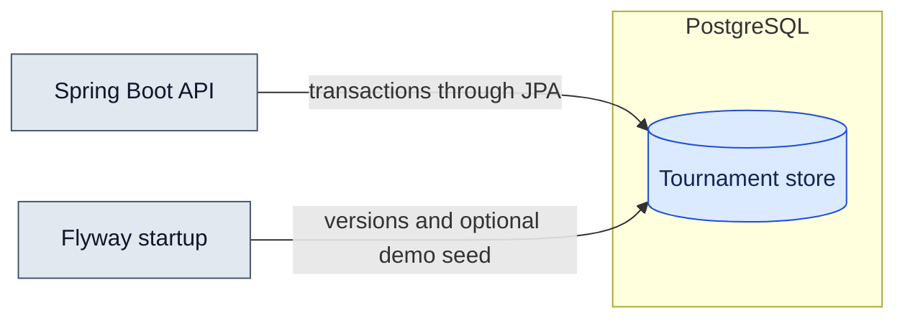

# PostgreSQL component overview

The [Tournament Store](<Tournament Store.md>) documents constraints and persistent data. [Principles and Patterns](<Principles and Patterns.md>) describes reliable schema and demo changes.
