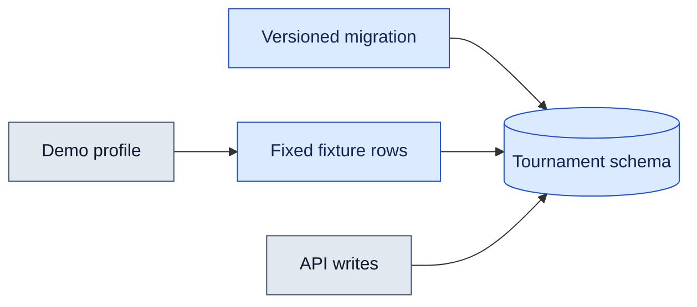

# PostgreSQL principles and patterns

| Concern | Existing behavior | Evidence |
| --- | --- | --- |
| Schema authority | Flyway executes versioned SQL. Hibernate validates at startup. | [V1 migration](<../../../backend/src/main/resources/db/migration/V1__create_tournament_schema.sql>), [configuration](<../../../backend/src/main/resources/application.yml>) |
| Cross-tournament references | Composite foreign keys keep the match and referenced teams and field in the same tournament. | V1 migration |
| Schedule reads | The index starts with tournament, start time and UUID. The API query orders by start and UUID. | V1 migration, [MatchRepository](<../../../backend/src/main/java/com/artisyn/tournamentiq/match/persistence/MatchRepository.java>) |
| Synthetic fixtures | The repeatable seed uses fixed values and conflict-safe insertion when the demo profile enables it. | [Demo seed](<../../../backend/src/main/resources/db/demo/R__seed_demo_tournaments.sql>) |

See [Tournament Store](<Tournament Store.md>) for the data model.
