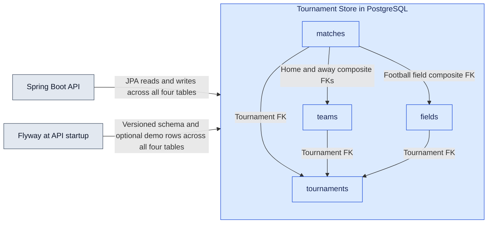

# Tournament Store

Tournament Store persists tournament setup, team and football field registrations, and manually assigned matches. The Spring Boot API owns application transactions. PostgreSQL enforces the storage constraints on each write. [PostgreSQL overview](00%20Overview.md) · [Versioned schema](../../../backend/src/main/resources/db/migration/V1__create_tournament_schema.sql)

## Schema and query contract

| Table or index | Contract |
| --- | --- |
| `tournaments` | UUID primary key. Name is required, limited to 120 characters, and checked after trimming spaces. |
| `teams`, `fields` | UUID primary keys. Each non-null `tournament_id` references a tournament. The name has the same constraint as tournament names. Each `(tournament_id, id)` pair is unique and available as a composite foreign-key target. |
| `matches` | UUID primary key, required tournament and participant references, and two required `TIMESTAMPTZ` values. Composite foreign keys pair the match's tournament UUID with each team UUID and the football field UUID. Check constraints require distinct teams and `ends_at > starts_at`. |
| `matches_schedule_idx` | Indexes `(tournament_id, starts_at, id)`. The match schedule query filters by tournament UUID and sorts by stored start time at microsecond precision, then by match UUID. |

[Versioned schema](../../../backend/src/main/resources/db/migration/V1__create_tournament_schema.sql#L1) · [Schedule query](../../../backend/src/main/java/com/artisyn/tournamentiq/match/persistence/MatchRepository.java#L11) · [Timestamp precision](../../../backend/src/main/java/com/artisyn/tournamentiq/match/domain/MatchAssignment.java#L19) · [Manual Scheduling](../API/Manual%20Scheduling.md)

## Initialize schema and demo data

1. Docker Compose starts `postgres:17-alpine` and waits for its health check before starting the backend. The named `tournament-data` volume holds the database files. Spring connects to the database through its datasource configuration. [Compose](../../../compose.yaml) · [Spring configuration](../../../backend/src/main/resources/application.yml)
2. On backend startup, Flyway applies the versioned schema before the repeatable demo migration. Hibernate validates the resulting schema. [Spring configuration](../../../backend/src/main/resources/application.yml) · [Versioned schema](../../../backend/src/main/resources/db/migration/V1__create_tournament_schema.sql)
3. Compose enables the `demo` Spring profile by default. This profile sets Flyway's `demo_enabled` placeholder to `true`. The repeatable SQL inserts tournaments, team and football field registrations, then matches with fixed UUIDs and offset timestamps. Each insert uses `ON CONFLICT (id) DO NOTHING`, which preserves rows with those UUIDs on a repeat run. With demo disabled, the SQL selects no rows for insertion and existing data remains. [Compose](../../../compose.yaml) · [Spring configuration](../../../backend/src/main/resources/application.yml) · [Repeatable migration](../../../backend/src/main/resources/db/demo/R__seed_demo_tournaments.sql)

## Verify storage behavior

Run `./mvnw test` from `backend/` with Java 21 and Docker. The integration tests use a separate PostgreSQL 17 container with the demo profile. They assert that Flyway supplies the fixed match schedule, that match time is returned in UTC, that the schedule is chronological and that the API rejects requests that reference another tournament's team or football field. The database constraints are defined in the migration. [API integration tests](../../../backend/src/test/java/com/artisyn/tournamentiq/TournamentApiIntegrationTest.java) · [Versioned schema](../../../backend/src/main/resources/db/migration/V1__create_tournament_schema.sql)

[PostgreSQL principles and patterns](Principles%20and%20Patterns.md)
