# Web component overview

```mermaid
flowchart LR
    User["Tournament organizer"]:::context
    subgraph Web["Web"]
        subgraph Workspace["Tournament Workspace in the browser"]
            App["React state and views"]:::required
            Client["Typed REST client"]:::required
            App -->|"Read and submit tournament data"| Client
        end
        Proxy["Nginx<br/>Vite in local development and preview"]:::required
        Client -->|"Same-origin HTTP under /api/tournaments"| Proxy
    end
    API["Spring Boot REST API"]:::context
    User -->|"Select tournaments, register teams and fields, assign matches"| App
    Proxy -->|"Forward REST requests"| API
    style Web fill:#e2e8f0,stroke:#475569,color:#0f172a
    style Workspace fill:#dbeafe,stroke:#1d4ed8,color:#172554
    classDef required fill:#dbeafe,stroke:#1d4ed8,color:#172554
    classDef context fill:#e2e8f0,stroke:#475569,color:#0f172a
```

Tournament Workspace owns browser state and sends same-origin requests through its REST client. Nginx serves the built React app and proxies API requests in Compose. Vite provides the proxy in local development and preview. [Tournament Workspace](<Tournament Workspace.md>) · [Web container](<../../Target Architecture (HLD)/v1/Containers/Web.md>) · [api.ts](../../../frontend/src/api.ts#L40) · [Dockerfile](../../../frontend/Dockerfile#L8) · [nginx.conf](../../../frontend/nginx.conf#L6) · [vite.config.ts](../../../frontend/vite.config.ts#L7)

[UI UX Patterns](<UI UX Patterns.md>) explains navigation, forms and filtering.
