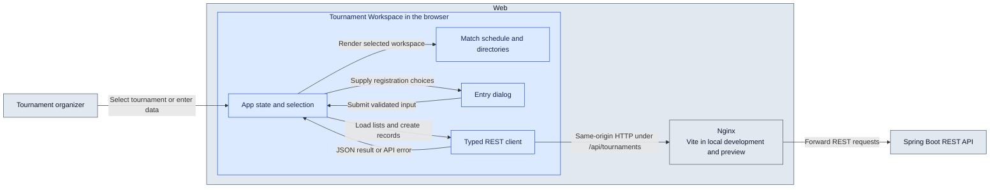

# Tournament Workspace

The workspace owns browser state for tournament selection, team and football field registration, and manual match scheduling. [Web component overview](<00 Overview.md>)

## Structure

| Module | Responsibility |
| --- | --- |
| [main.tsx](../../../frontend/src/main.tsx) and [App.tsx](../../../frontend/src/App.tsx#L32) | Mount the React app and own tournament, section, result, dialog and notice state. |
| [WorkspaceViews.tsx](../../../frontend/src/components/WorkspaceViews.tsx#L66) | Render schedule and registration directories. Keep the field filter in the schedule view. |
| [EntryDialog.tsx](../../../frontend/src/components/EntryDialog.tsx#L41) | Collect names or match assignments, guard pending submissions, and show validation errors. |
| [api.ts](../../../frontend/src/api.ts#L40) and [dates.ts](../../../frontend/src/dates.ts#L20) | Adapt JSON responses, Problem Details and browser-local date values at the application boundary. |

## Execution

1. On load, the app fetches the tournament list and selects the first returned tournament if there is no active selection. Selecting another tournament resets the section to Schedule and clears the previous workspace. The API client fetches teams, fields and schedule in parallel. The effects abort obsolete reads and ignore aborted results. [App.tsx](../../../frontend/src/App.tsx#L49) · [api.ts](../../../frontend/src/api.ts#L65)
2. The match schedule filters the loaded matches by football field ID in the browser. It groups visible matches by the browser-local date of kickoff and shows the end date when a match crosses local midnight. [Schedule](../../../frontend/src/components/WorkspaceViews.tsx#L66) · [MatchEnd](../../../frontend/src/components/WorkspaceViews.tsx#L23) · [dates.ts](../../../frontend/src/dates.ts#L20)
3. Add match is enabled when the tournament has at least two registered teams and one football field. The dialog requires two different teams and an end instant after the start. It parses each `datetime-local` value in the browser's time zone, rejects values that change when formatted back to local minutes, and sends ISO UTC timestamps. [App.tsx](../../../frontend/src/App.tsx#L221) · [EntryDialog.tsx](../../../frontend/src/components/EntryDialog.tsx#L24) · [dates.ts](../../../frontend/src/dates.ts#L28)
4. After a successful match submission, the browser inserts the returned match and sorts the list by `Date.parse(startsAt)` in milliseconds, then compares the UUID strings with `localeCompare` for ties. On load, the browser uses the API's order by stored start time at microsecond precision, then by match UUID. Distinct starts within one millisecond can therefore appear in a different order after an insertion. A failed submission keeps the dialog open and shows the error. [App.tsx](../../../frontend/src/App.tsx#L113) · [api.ts](../../../frontend/src/api.ts#L71) · [MatchRepository](../../../backend/src/main/java/com/artisyn/tournamentiq/match/persistence/MatchRepository.java#L11) · [MatchAssignment](../../../backend/src/main/java/com/artisyn/tournamentiq/match/domain/MatchAssignment.java#L19) · [EntryDialog.tsx](../../../frontend/src/components/EntryDialog.tsx#L55)

## Integration contract

The client sends same-origin HTTP requests under `/api/tournaments`. In Compose, Nginx forwards `/api/` to `backend:8080`. In local development and preview, Vite forwards `/api` to `localhost:8080`. [api.ts](../../../frontend/src/api.ts#L40) · [nginx.conf](../../../frontend/nginx.conf#L6) · [vite.config.ts](../../../frontend/vite.config.ts#L7)

| Operation | Suffix or payload |
| --- | --- |
| List tournaments or create a tournament | GET or POST on the base path. Creation supplies `{ name }`. |
| List or register teams and football fields | GET or POST on `/{id}/teams` or `/{id}/fields`. Registration supplies `{ name }`. |
| Load the schedule or add a match | GET on `/{id}/schedule`. POST on `/{id}/matches` supplies `homeTeamId`, `awayTeamId`, `fieldId`, `startsAt` and `endsAt`. |

A non-success response becomes an `ApiError` with the server's `detail` and any field messages, or a fallback message when those are unavailable. A failed read offers retry for the affected list or workspace. The dialog associates field messages with invalid controls. [api.ts](../../../frontend/src/api.ts#L40) · [App.tsx](../../../frontend/src/App.tsx#L25) · [EntryDialog.tsx](../../../frontend/src/components/EntryDialog.tsx#L80)

## Verification

Run `npm ci` and `npm run build` in `frontend/` to install locked dependencies, type-check and build. Verify the dialog and schedule together when changing time handling or REST inputs. [package.json](../../../frontend/package.json) · [UI UX Patterns](<UI UX Patterns.md>)
