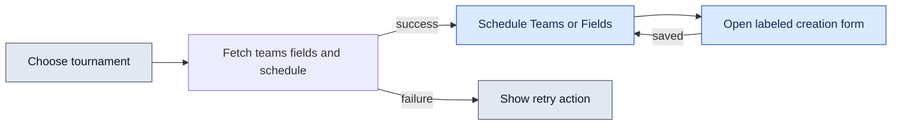

# Web UI and UX patterns

| Pattern | Behavior | Evidence |
| --- | --- | --- |
| Workspace | Selecting a tournament resets the active view to Schedule. The three sections share the selected tournament data. | [App.tsx](<../../../frontend/src/App.tsx>) |
| Empty and failed reads | A request failure offers retry. Empty schedules show prerequisites for manual match entry. | [WorkspaceViews.tsx](<../../../frontend/src/components/WorkspaceViews.tsx>) and App.tsx |
| Match entry | Native dialog labels identify each control. Validation errors remain in the dialog while success closes it. | [EntryDialog.tsx](<../../../frontend/src/components/EntryDialog.tsx>) |
| Dates | Group fixtures by the browser's local day and display the time-zone identifier. | [dates.ts](<../../../frontend/src/dates.ts>) and WorkspaceViews.tsx |

See [Tournament Workspace](<Tournament Workspace.md>) for client wiring.
