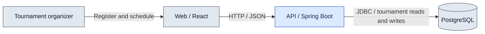
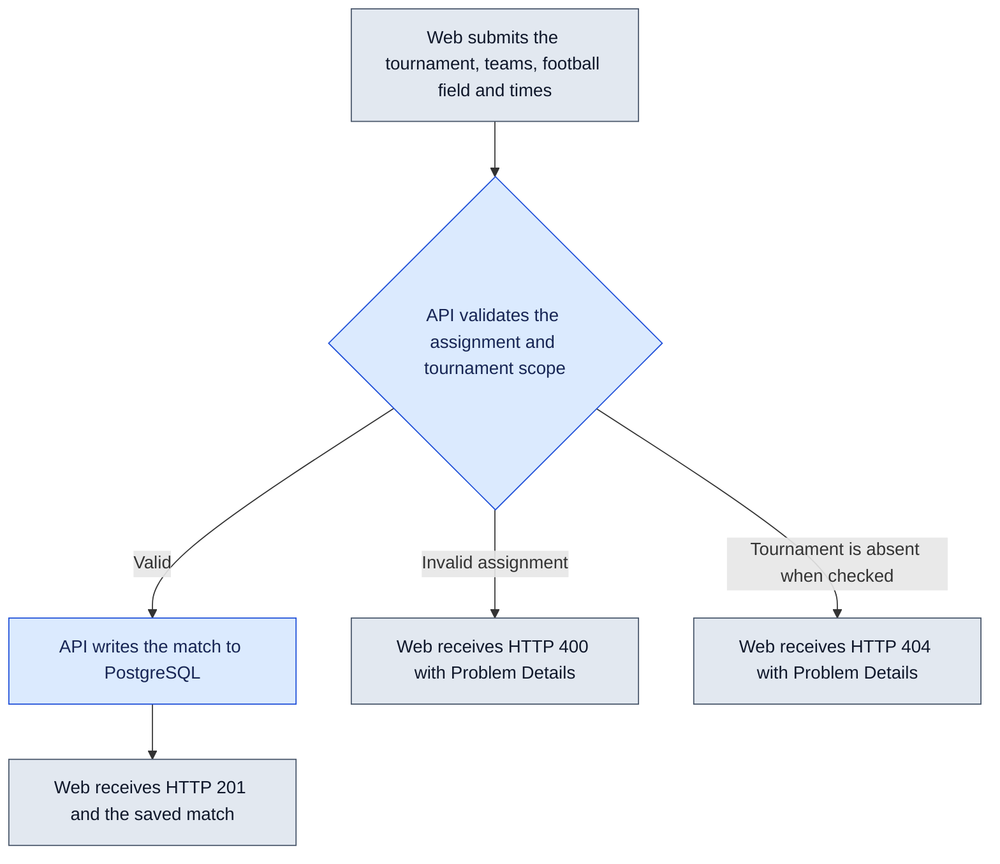

# API

The API is the business boundary for tournament setup, team and football field registrations, and manually assigned matches. The Web container calls the API on behalf of organizers. The API applies tournament rules and uses PostgreSQL for durable state. [System Overview](<../System Overview.md>) · [API component overview](<../../../System Architecture (LLD)/API/00 Overview.md>)

## Submit a match

The API requires distinct teams, a later end time, and participants registered in the requested tournament. An invalid assignment is rejected before a match row is written. A schedule request reads stored matches in start-time order. [Manual Scheduling LLD](<../../../System Architecture (LLD)/API/Manual Scheduling.md>)

## Boundary contracts

| Relationship | Contract |
| --- | --- |
| Web → API for tournament setup | HTTP JSON requests create or read tournaments and create or list team and football field registrations within a tournament. [Tournament Registrations LLD](<../../../System Architecture (LLD)/API/Tournament Registrations.md>) |
| Web → API for matches | The Web supplies tournament and participant IDs and start and end times with offsets. Schedule responses return the participants and UTC times. |
| API → Web for failures | Client-facing errors use Problem Details with a machine-readable code and field errors where applicable. [API principles and patterns](<../../../System Architecture (LLD)/API/Principles and Patterns.md>) |
| API → PostgreSQL | The API persists tournament state through JPA. Flyway applies the schema at API startup. |

The baseline accepts explicit match submissions. Automatic schedule generation, fixture generation, optimization and minimum-rest rules belong to separately scoped work.
