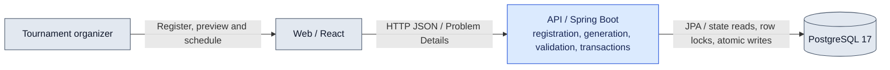
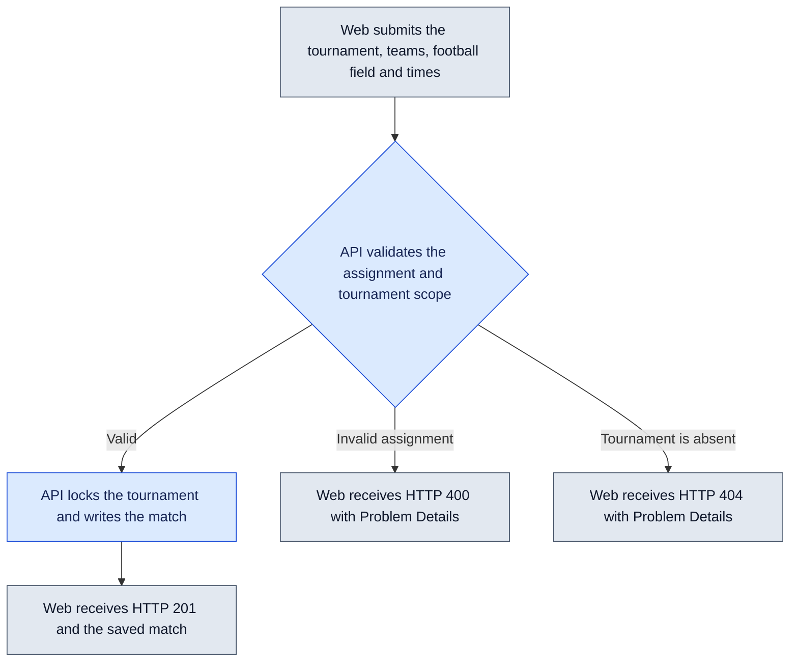

# API



The API is the business boundary for tournament setup, registrations, manual match assignment and generated scheduling. It owns tournament rules, deterministic fixture placement, independent whole-schedule validation and transaction boundaries. The Web calls it on behalf of organizers, and PostgreSQL retains durable state. [System Overview](<../System Overview.md>) · [API component overview](<../../../System Architecture (LLD)/API/00 Overview.md>)

## Submit a match



The manual endpoint retains its request, response and validation rules. The API additionally locks the tournament row before it reads scoped teams and football fields or writes the match. A schedule request reads stored matches in chronological order. [Manual Scheduling LLD](<../../../System Architecture (LLD)/API/Manual Scheduling.md>)

## Generate and save a schedule

```mermaid
sequenceDiagram
  participant W as Web
  participant A as API
  participant D as PostgreSQL

  rect rgb(219, 234, 254)
    W->>A: POST /schedule/preview
    A->>D: Read tournament, teams, fields and matches
    alt A match already exists
      A-->>W: 409 SCHEDULE_STATE_CONFLICT
    else Match schedule is empty
      A->>A: Exact fixtures + bounded CSP placement
      A->>A: Independent whole-schedule validation
      A-->>W: Proposed matches + validation report
    end
  end
  rect rgb(204, 251, 241)
    W->>A: POST /schedule with complete proposal
    A->>D: Begin; lock tournament; reload state
    alt State changed or a match exists
      A->>D: Roll back
      A-->>W: 409 SCHEDULE_STATE_CONFLICT
    else Proposal is independently valid
      A->>D: Insert 1-66 matches; commit once
      D-->>A: Persisted match schedule
      A-->>W: HTTP 201
    end
  end
```

Preview is read-only and runs only for an empty match schedule. The API enumerates every unordered team pair, places fixtures with deterministic bounded CSP backtracking, and independently validates the complete result. Save accepts the complete proposal and configuration, acquires the tournament row first, reloads teams, football fields and matches, validates again, and commits the full match schedule or nothing.

Only exhaustion of the complete finite candidate tree returns `PROVEN_INFEASIBLE`. Reaching the configured deterministic work bound returns `SEARCH_LIMIT_EXHAUSTED`; a wall-clock safety stop returns `INTERNAL_FAILURE`. Team rest is measured from the previous match end to the next match start. Validation canonicalizes the complete proposal, so request order does not change the result.

## Boundary contracts

| Relationship | Contract |
| --- | --- |
| Web → API for tournament setup | HTTP JSON requests create or read tournaments and create or list team and football field registrations within a tournament. Registration writes use the tournament-first lock order. [Tournament Registrations LLD](<../../../System Architecture (LLD)/API/Tournament Registrations.md>) |
| Web → API for manual matches | `POST /api/tournaments/{tournamentId}/matches` retains its external contract. Schedule responses return participants and absolute timestamps. |
| Web → API for generated schedules | `POST /api/tournaments/{tournamentId}/schedule/preview` returns a side-effect-free proposal and ordered validation report. `POST /api/tournaments/{tournamentId}/schedule` resubmits the proposal for atomic save. |
| API → Web for failures | Problem Details uses stable outcome codes and preserves ordered structured violations. Invalid input is `400`, state conflict is `409`, capacity or deterministic search outcomes are `422`, and internal failure is `500`. [API principles and patterns](<../../../System Architecture (LLD)/API/Principles and Patterns.md>) |
| API → PostgreSQL | JPA reads tournament state, acquires the tournament row before schedule-invalidating writes, and inserts a generated schedule in one transaction. Flyway still owns schema evolution. |

The API remains one Spring Boot container in the existing Docker Compose topology. Generated scheduling adds no runtime service, solver dependency or database schema change. Concrete finite-domain, deterministic-work and lock-wait limits are calibrated and versioned before generator implementation.
