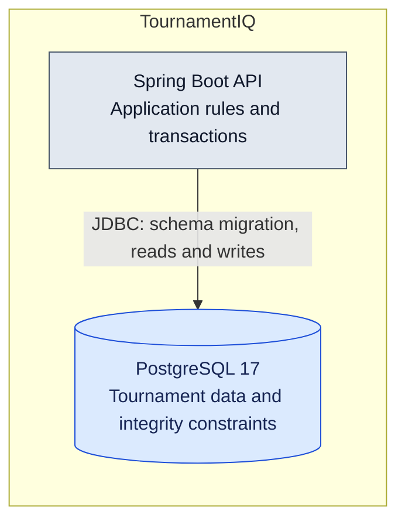

# PostgreSQL

PostgreSQL stores tournaments, registered teams and football fields, and manually assigned matches for the local TournamentIQ demo. The API is the application client and owns transaction boundaries. Schema evolution belongs to Flyway at API startup. [System overview](../System%20Overview.md) · [PostgreSQL implementation](../../../System%20Architecture%20%28LLD%29/PostgreSQL/00%20Overview.md)

## Startup and persistence

Docker Compose starts PostgreSQL and uses its readiness check to gate API startup. On startup, the API runs the versioned schema migration and the profile-controlled repeatable demo migration through Flyway, then Hibernate validates the schema. A named PostgreSQL volume persists the data across ordinary Compose restarts. [Compose services](../../../../compose.yaml) · [Tournament Store](../../../System%20Architecture%20%28LLD%29/PostgreSQL/Tournament%20Store.md)

## Application data flows

| Trigger | Boundary interaction and outcome |
| --- | --- |
| A user registers a tournament, team or football field, or submits a match through the API | The API validates the request and writes through its persistence layer. PostgreSQL enforces tournament ownership of referenced data, requires distinct teams for a match and rejects invalid match time intervals. The API maps application validation failures to the REST response. |
| A user opens a match schedule | The API queries PostgreSQL for that tournament and requests rows in chronological order with a stable tie-breaker. PostgreSQL has a corresponding schedule index. The API maps the returned rows to its REST representation. |

[Manual Scheduling](../../../System%20Architecture%20%28LLD%29/API/Manual%20Scheduling.md) · [Tournament Store](../../../System%20Architecture%20%28LLD%29/PostgreSQL/Tournament%20Store.md)
