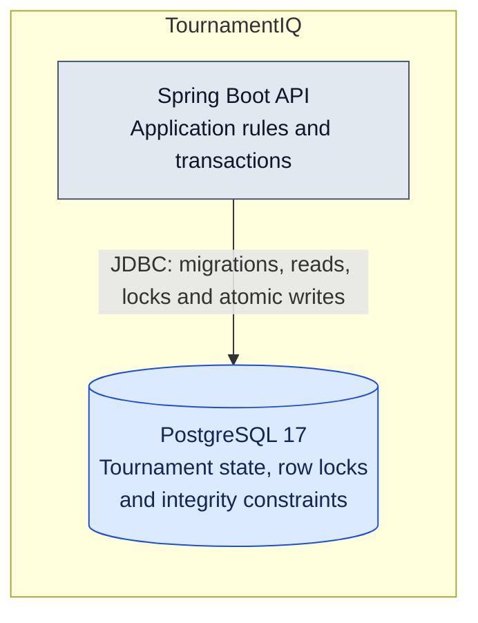

# PostgreSQL

PostgreSQL stores tournaments, registered teams and football fields, and manual or generated matches. The API is the only application client, owns domain validation and transaction boundaries, and uses the tournament row as the serialization point for schedule-invalidating writes. [System overview](../System%20Overview.md) · [PostgreSQL implementation](../../../System%20Architecture%20%28LLD%29/PostgreSQL/00%20Overview.md)

## Startup and persistence

Docker Compose starts PostgreSQL and uses its readiness check to gate API startup. The API applies versioned Flyway migrations and the profile-controlled repeatable demo seed, then Hibernate validates the schema. A named volume persists data across ordinary Compose restarts. Generated scheduling uses the existing tournament, registration and match tables: it adds no table, column, index or Flyway migration. [Compose services](../../../../compose.yaml) · [Tournament Store](../../../System%20Architecture%20%28LLD%29/PostgreSQL/Tournament%20Store.md)

## Application data flows

| Trigger | Boundary interaction and outcome |
| --- | --- |
| An organizer requests a schedule preview | The API reads the tournament, all registered teams, selected football fields and existing matches. Preview writes no row and stops before generation when a match already exists. |
| An organizer saves a generated schedule | The API begins one transaction, locks the tournament row, reloads tournament-scoped state, independently validates the submitted proposal, and inserts 1–66 existing match rows. A conflict or failure rolls back the complete batch. |
| An organizer creates a manual match or registers a team or football field | The API locks the tournament row before scoped reads and writes. Generated save and existing writers therefore cannot silently combine state for one tournament. |
| An organizer opens a match schedule | The API queries all stored matches for that tournament in chronological order with a stable tie-breaker. PostgreSQL uses the existing schedule index, regardless of whether matches were entered manually or generated. |

PostgreSQL enforces tournament ownership of referenced data, distinct teams and valid match intervals. The API owns round-robin completeness, time-window, overlap, turnaround and minimum-rest validation. Lock timeout, deadlock, constraint failure or application failure rolls back the active transaction; no partial generated schedule remains.

[Manual Scheduling](../../../System%20Architecture%20%28LLD%29/API/Manual%20Scheduling.md) · [Tournament Store](../../../System%20Architecture%20%28LLD%29/PostgreSQL/Tournament%20Store.md)
