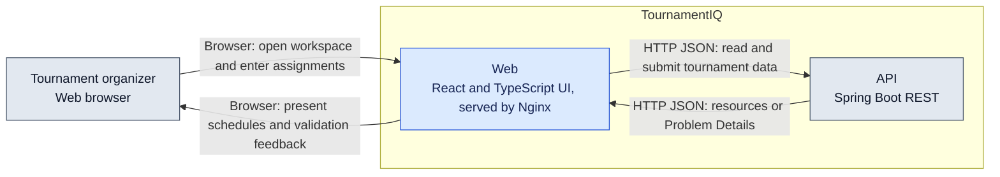

# Web

The Web container gives tournament organizers one workspace to create and select tournaments, register teams and football fields, assign matches, and view schedules. It owns presentation and browser interaction state. The API owns tournament data and enforces write rules. [System Overview](<../System Overview.md>) · [Web component overview](<../../../System Architecture (LLD)/Web/00 Overview.md>)

## Primary flow

1. The organizer opens the workspace and selects a tournament. The Web container reads its registered teams, football fields and schedule from the API. A failed read shows an error and offers retry.
2. To add a match, the organizer selects two registered teams and a football field, then enters start and end times in the browser's time zone. The Web container validates the entry and sends team and field identifiers with UTC timestamps to the API.
3. The API returns the created match or a failure. The Web container inserts a successful result in the schedule and shows browser-local times. On failure, it keeps the entry form open and displays the available error details. [Tournament Workspace LLD](<../../../System Architecture (LLD)/Web/Tournament Workspace.md>)

## Boundary contracts

| Boundary | Exchange |
| --- | --- |
| Organizer → Web | Tournament selection, registration names, and manually selected match participants, field and local times. |
| Web → API | Same-origin HTTP requests under `/api/tournaments`. Nginx forwards the API route in Compose. Vite provides the same route in local development. |
| API → Web | JSON tournament records, team and field registrations, schedule entries, or failure details. Match timestamps represent absolute instants. |
| Web → Organizer | Browser-local schedule grouped by start date and filterable by football field, along with loading, empty, retry and form-error states. |

The local demo uses manual match assignment. Schedule filtering and date presentation happen in the browser. Durable writes go through the API. [Tournament Workspace LLD](<../../../System Architecture (LLD)/Web/Tournament Workspace.md>) · [UI UX Patterns](<../../../System Architecture (LLD)/Web/UI UX Patterns.md>)
