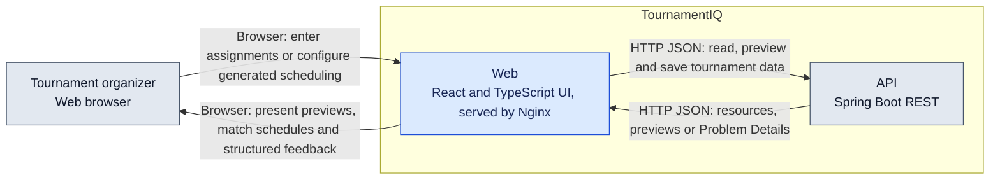

# Web

The Web container gives tournament organizers one workspace to create and select tournaments, register teams and football fields, assign matches manually, preview a generated match schedule, save it explicitly, and view persisted matches. It owns presentation and browser interaction state. The API owns tournament data, schedule generation and write rules. [System Overview](<../System Overview.md>) · [Web component overview](<../../../System Architecture (LLD)/Web/00 Overview.md>)

## Primary flow

1. The organizer opens the workspace and selects a tournament. The Web container reads its registered teams, football fields and match schedule from the API. A failed read shows an error and offers retry.
2. To add a match, the organizer selects two registered teams and a football field, then enters start and end times in the browser's time zone. The Web container validates the entry and sends team and field identifiers with UTC timestamps to the API.
3. To generate a match schedule, the organizer enters tournament dates, a daily playing window, an IANA time zone, selected football fields, match duration and minimum team rest. The Web container requests a read-only preview from the API.
4. The Web container presents the canonical proposal and every ordered machine-readable validation violation. Editing configuration invalidates the proposal. The organizer explicitly saves a successful preview.
5. The API returns the created match, preview, persisted match schedule or Problem Details. Persisted instants display in the browser's time zone. A `409 SCHEDULE_STATE_CONFLICT` makes the Web reload tournament state before another preview. [Tournament Workspace LLD](<../../../System Architecture (LLD)/Web/Tournament Workspace.md>)

## Boundary contracts

| Boundary | Exchange |
| --- | --- |
| Organizer → Web | Tournament selection, registration names, manual match assignments, and generated-scheduling configuration and save intent. |
| Web → API | Same-origin HTTP requests under `/api/tournaments`, including read-only schedule preview and explicit generated-schedule save. Nginx forwards the API route in Compose. Vite provides the same route in local development. |
| API → Web | JSON tournament records, registrations, preview proposals, persisted match schedules, or Problem Details with a stable code and ordered violations. Match timestamps represent absolute instants. |
| Web → Organizer | Canonical preview proposals, browser-local persisted schedules, repeated validation violations, and loading, empty, retry, conflict and form-error states. |

Manual match assignment and generated scheduling share the tournament workspace. A preview remains browser state until explicit save. Match-schedule filtering and date presentation happen in the browser, and every durable write goes through the API. [Tournament Workspace LLD](<../../../System Architecture (LLD)/Web/Tournament Workspace.md>) · [UI UX Patterns](<../../../System Architecture (LLD)/Web/UI UX Patterns.md>)
