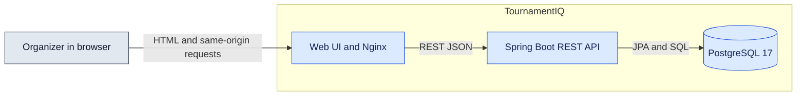

# TournamentIQ system overview

| Container | Runtime boundary | Primary responsibility |
| --- | --- | --- |
| [Web](<Containers/Web.md>) | Static React application and request proxy | Tournament selection, registration and match entry |
| [API](<Containers/API.md>) | One Spring Boot process | Feature-scoped REST, domain validation and transactions |
| [PostgreSQL](<Containers/PostgreSQL.md>) | One database service | Persistent tournament assignments and chronological queries |

An organizer creates or selects a tournament, registers teams and fields, then submits an explicit matchup and its time range. The API validates the assignment against the tournament and writes it transactionally. Workspace requests return the schedule in chronological order. The Web interface displays instants in the browser's time zone.

The baseline is a local Docker Compose demonstration. Compose starts PostgreSQL, waits for the API, then starts Web. Flyway initializes the schema and optionally seeds the demo. See [Compose](<../../../compose.yaml>), [the LLD index](<../../System Architecture (LLD)/README.md>) and [System Sizing](<System Sizing.md>).
