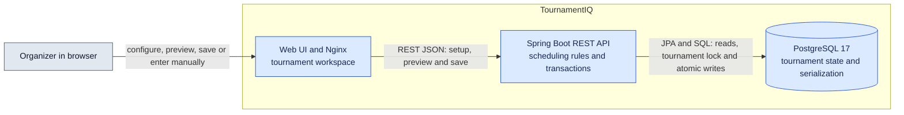

# TournamentIQ system overview

| Container | Runtime boundary | Primary responsibility |
| --- | --- | --- |
| [Web](<Containers/Web.md>) | Static React application and request proxy | Tournament setup, manual match entry, generated-schedule configuration, preview and explicit save |
| [API](<Containers/API.md>) | One Spring Boot process | REST, exact fixture enumeration, deterministic bounded placement, independent validation and transaction ownership |
| [PostgreSQL](<Containers/PostgreSQL.md>) | One database service | Persistent tournament state, chronological match queries and tournament-row serialization |

An organizer creates or selects a tournament and registers teams and football fields. Manual scheduling submits one explicit matchup. Generated scheduling sends one configuration for a read-only preview, then explicitly submits the complete proposal for save. The API reloads tournament state under the tournament-row lock, validates the complete match schedule independently and inserts every generated match in one transaction. Workspace requests return the match schedule chronologically, and the Web displays persisted instants in the browser's time zone.

The baseline is a local Docker Compose demonstration. Compose starts PostgreSQL, waits for the API, then starts Web. Flyway initializes the schema and optionally seeds the demo. See [Compose](<../../../compose.yaml>), [the LLD index](<../../System Architecture (LLD)/README.md>) and [System Sizing](<System Sizing.md>).
