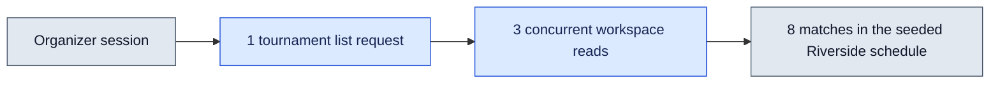

# TournamentIQ local sizing

The sizing scope covers one opening of the seeded Riverside Cup workspace and one generated-scheduling organizer action on the documented local Compose stack.

| Input | Quantity | Source and condition |
| --- | --- | --- |
| Demo data | 2 tournaments, 8 teams, 3 fields and 8 matches | [Flyway demo seed](<../../../backend/src/main/resources/db/demo/R__seed_demo_tournaments.sql>) with the demo profile |
| Tournament selection | 1 list request plus 3 workspace requests | [Web request code](<../../../frontend/src/api.ts>) and [selection logic](<../../../frontend/src/App.tsx>) in one initial load outside React development StrictMode |
| Subsequent tournament switch | 3 workspace GET requests | Web request code once per selected ID, without the list refetch |
| Seeded schedule response | 8 match items | Riverside Cup demo, before user-added records |
| Generated tournament size | 2–12 registered teams | [TQ-001 requirements](<../../../requirements/TQ-001.md>) |
| Generated fixture count | `N × (N − 1) / 2`, or 1–66 matches | Derived from the confirmed team bound |
| Generated request pattern | 1 read-only preview plus 0 or 1 explicit save | [Approved scheduling architecture](<../../Stories/design/[TQ-001] Constraint-Based Round-Robin Schedule Generation/solution/Architecture.md>) |
| Generated persistence | Preview inserts 0 rows; save inserts 1–66 match rows in 1 transaction | Approved scheduling architecture |
| Built JS and CSS | 241,897 + 19,104 = 261,001 bytes | Local Vite build artifacts, before transfer compression and excluding fonts, the HTML and stadium image |
| Built HTML and stadium image | 553 + 50,970 bytes | Local Vite build artifacts. Together with JS and CSS, these assets total 312,524 bytes before transfer compression and excluding fonts |

Artifact sizes were measured on 2026-11-27 after `npm run build` in `frontend/`, using `wc -c frontend/dist/index.html frontend/dist/stadium.webp frontend/dist/assets/*.js frontend/dist/assets/*.css`.

Initial API demand is **1 list + 3 workspace reads = 4 GET requests per load**. A repeatable workload of N such loads produces 4 × N GET requests; switching adds 3 × S for S selections. The grouped workspace reads can overlap. This counts requests rather than estimating throughput.

## Generated-scheduling planning boundary

One organizer action runs one bounded deterministic placement search. The candidate-domain size is governed by the tournament date range, daily playing window, selected football fields and one-minute candidate grid. Before generator implementation, the calibration delivery unit fixes and versions the accepted domain caps, deterministic work budget, wall-clock safety deadline, tournament-lock timeout and benchmark pass threshold. Maximum-bound replay and concurrency scenarios provide the acceptance evidence.

The list and match-schedule requests have no pagination parameters in the baseline API. Their response volume follows the number of returned records. The local baseline sets no concurrency or latency target. Validate service time and saturation under a confirmed workload before using these counts for a capacity decision.
